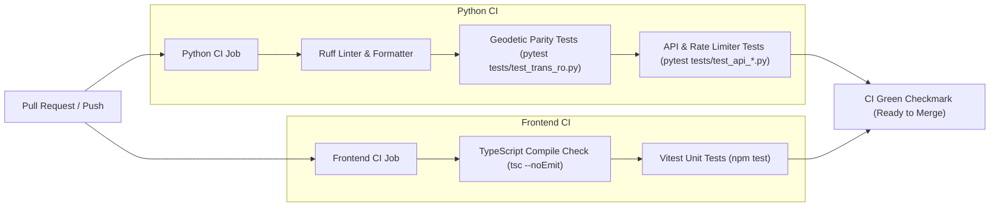

# PyTransDatRO: Deployment & Infrastructure Specification

## 1. Executive Summary & Objectives
This document specifies the deployment architecture, container configuration, persistent storage strategy, security safeguards, and multi-repository governance for deploying **PyTransDatRO** to the community infrastructure maintained by **geospatial.org**.

The design balances:
1. **Open Source Independence:** The project remains a sovereign, independent open-source project under the MIT License on [`bogdanmorosanu/PyTransDatRO`](https://github.com/bogdanmorosanu/PyTransDatRO).
2. **Community Governance via GitHub Fork:** `geospatial.org` maintains an official GitHub Fork on [`geospatialorg/PyTransDatRO`](https://github.com/geospatialorg/PyTransDatRO), providing native 1-click cross-repository Pull Requests, public attribution, and complete freedom to diverge whenever needed.
3. **Operational Robustness:** A 2-container Docker architecture with persistent SQLite volumes, reverse-proxy header preservation for rate-limiting, Docker log rotation, automated GitHub CI testing for team collaborators, and controlled deployment via SSH.

---

## 2. Container Architecture & System Topology

The system is deployed using Docker and Docker Compose, split into **two dedicated containers** running on an internal Docker bridge network:

```
[ User Browser / Desktop CLI Clients ]
                  │
                  ▼  Host Port (Default: 80, configurable via .env WEBAPP_PORT)
┌────────────────────────────────────────────────────────────────────────┐
│ Container 1: Web App & Reverse Proxy (web)                             │
│ - Image: nginx:alpine (Multi-stage build from webapp/)                 │
│ - Hosts pre-compiled Vite + TypeScript static assets                   │
│ - Proxies /api/*, /docs, /openapi.json to Backend                      │
│ - SPA fallback: try_files $uri $uri/ /index.html                       │
│ - client_max_body_size: 50M (matches backend max upload limit)         │
│ - Passes X-Forwarded-For & X-Real-IP (critical for rate limiting)      │
└────────────────────────────────┬───────────────────────────────────────┘
                                 │
                                 │ Internal Docker Network (http://backend:8000)
                                 │ (Waits for backend to be healthy)
                                 ▼
┌────────────────────────────────────────────────────────────────────────┐
│ Container 2: Backend REST API (backend)                                │
│ - Image: python:3.11-slim (FastAPI + Uvicorn)                          │
│ - In-Memory Geodetic Engine (pytransdatro pure Python standard lib)   │
│ - Non-blocking SQLite WAL Telemetry Logger                             │
│ - Internal Port: 8000 (not published to host)                         │
│ - Healthcheck: GET /health verifies grid pre-warming & telemetry       │
└────────────────────────────────┬───────────────────────────────────────┘
                                 │
                                 ▼ Persistent Volume Mount
                 ┌──────────────────────────────────────┐
                 │ Host Volume Directory (./logs)       │
                 │ Mounted to: /app/logs                │
                 │ - usage.db (auto-created on startup) │
                 │ - legacy_stats.db (seeded via SCP)   │
                 │ - feedback.log                       │
                 └──────────────────────────────────────┘
```

### 2.1 Container Specifications

#### Container 1: Web App & Reverse Proxy (`web`)
- **Base Image:** `nginx:alpine`
- **Build Strategy:** Multi-stage build:
  - *Stage 1 (Node 20 Alpine):* Compiles TypeScript and builds production static bundle (`tsc && vite build`) into `/build/dist`.
  - *Stage 2 (Nginx Alpine):* Copies compiled assets into `/usr/share/nginx/html` and injects production `nginx.conf`.
- **Port Mapping:** `${WEBAPP_PORT:-80}:80`.
- **Nginx Configuration Directives:**
  ```nginx
  server {
      listen 80;
      server_name localhost;

      # Allow file transformations up to 50MB (matches PYTRANSDAT_MAX_FILE_UPLOAD_BYTES)
      client_max_body_size 50M;

      # Serve Web App static bundle
      location / {
          root /usr/share/nginx/html;
          index index.html;
          try_files $uri $uri/ /index.html;
      }

      # Reverse proxy to FastAPI backend with client IP preservation
      location ~ ^/(api|docs|openapi.json) {
          proxy_pass http://backend:8000;
          proxy_http_version 1.1;
          proxy_set_header Host $host;
          proxy_set_header X-Real-IP $remote_addr;
          proxy_set_header X-Forwarded-For $proxy_add_x_forwarded_for;
          proxy_set_header X-Forwarded-Proto $scheme;

          # Streaming file transformation timeout support (5 minutes)
          proxy_read_timeout 300s;
          proxy_send_timeout 300s;
      }
  }
  ```
- **Reverse Proxy Readiness:** Operates over standard HTTP. If geospatial.org uses an outer reverse proxy (e.g. Traefik, Cloudflare, HAProxy, or host-level Nginx) for HTTPS/SSL termination, all traffic is forwarded to port 80 without SSL modification.

#### Container 2: Backend API & Geodetic Engine (`backend`)
- **Base Image:** `python:3.11-slim`
- **Engine Isolation:** The computation engine (`pytransdatro`) is executed **in-memory within the Python process**, ensuring sub-millisecond coordinate transformations without inter-process network overhead.
- **Internal Port:** 8000 (accessible only by the `web` container on the internal Docker network).
- **Environment Invariants:** `PYTHONDONTWRITEBYTECODE=1`, `PYTHONUNBUFFERED=1`, `PYTHONPATH=/app`.
- **Healthcheck & Startup Synchronization:**
  FastAPI pre-warms binary grid files on startup (`spg_reader.py` / `TransRO` singleton in `api/main.py`).
  ```dockerfile
  HEALTHCHECK --interval=15s --timeout=5s --start-period=5s --retries=3 \
      CMD python -c "import urllib.request; urllib.request.urlopen('http://localhost:8000/health')" || exit 1
  ```
  In `docker-compose.yml`, the `web` container declares:
  ```yaml
  depends_on:
    backend:
      condition: service_healthy
  ```
  This ensures Nginx will not forward public web traffic until the geodetic grid reader has loaded and passed health checks.

---

## 3. Persistent Storage, SQLite WAL & Safety Rules

The application relies on SQLite databases stored in `/app/logs`:

| Database / Log | Role | Lifecycle & Initialization |
| :--- | :--- | :--- |
| **`usage.db`** | Active usage telemetry (anonymized 1 km spatial & ISO-week binned metrics) | **Auto-Created:** Created and migrated automatically on container startup by `SqliteUsageLogger` in SQLite WAL mode. |
| **`legacy_stats.db`** | Historical usage statistics extracted from the legacy ANCPI TransDatOnline MySQL dumps | **One-Time Upload:** Copied once to the server host's `./logs/` directory via SCP/SFTP during first-time server setup. Ignored in Git. |
| **`feedback.log`** | JSON-lines log of user feedback submissions | **Auto-Created:** Appended to by feedback endpoint. |

### 3.1 Docker Volume Strategy
- The host directory `./logs` is mounted to `/app/logs` inside the backend container.
- Container rebuilds, restarts, and image updates **never overwrite or erase** the database files.

### 3.2 SQLite WAL Mode Live Backup Procedure
Because `usage.db` runs in Write-Ahead Logging (`WAL`) mode, raw copying (`cp usage.db backup.db`) while the service is running can capture an uncommitted or corrupt state because active writes live in `usage.db-wal`.
- **Safe Live Backup Command:**
  ```bash
  docker compose exec backend python -c "import sqlite3; conn = sqlite3.connect('/app/logs/usage.db'); conn.execute('PRAGMA wal_checkpoint(TRUNCATE);'); backup = sqlite3.connect('/app/logs/usage_backup.db'); conn.backup(backup); conn.close(); backup.close()"
  ```
- This forces a safe WAL flush and creates a consistent snapshot without shutting down the service.

---

## 4. Rate Limiting & Client IP Preservation

The FastAPI backend enforces in-memory sliding-window rate limiting via `api/middleware/rate_limit.py`:
- **Point transformations:** 60 requests / minute / IP
- **Batch & File uploads:** 10 requests / minute / IP
- **Documentation & Health:** Unmetered

> [!IMPORTANT]
> Because Nginx acts as an internal reverse proxy in front of FastAPI, Nginx **must** forward client IPs using `proxy_set_header X-Forwarded-For $proxy_add_x_forwarded_for;`.
> If this header were omitted, FastAPI would perceive all incoming traffic as originating from Nginx's internal container IP (`172.18.0.x`), causing all global users to share a single rate-limit bucket and triggering false `429 Too Many Requests` errors.

---

## 5. Multi-Repository Governance & Open Source Workflow (The GitHub Fork Model)

To preserve the independence of the open-source project while supporting community hosting:

```
[ Upstream Repository (Original Source) ]
https://github.com/bogdanmorosanu/PyTransDatRO
  - Author & Owner: Bogdan Moroșanu
  - License: MIT
  - Independent feature development, experiments, and versions
                             │
                             ▼  GitHub Fork
[ Downstream Repository (Official Community Fork) ]
https://github.com/geospatialorg/PyTransDatRO
  - Community deployment host maintained by geospatial.org
  - Maintained by Bogdan (as Admin) & geospatial administrators
  - Native 1-click Pull Requests from Upstream
  - Automated CI tests run on PR
  - PR reviewed and merged into main
                             │
                             ▼  Controlled Release & Manual SSH Deploy
[ Live Production Server ]
https://transdat.geospatial.org (or target domain)
```

### 5.1 Benefits of the Native Fork Structure
1. **Public Attribution:** The community repository clearly displays *"forked from bogdanmorosanu/PyTransDatRO"*, cementing your open-source project as the upstream authority.
2. **Native 1-Click Pull Requests:** When you push a release or bugfix to your personal repository, you simply visit GitHub and click **"Contribute -> Open Pull Request"**. GitHub compares the repositories natively.
3. **No Terminal Push Hassle:** You never have to configure or push to a secondary git remote from your local computer. You only push to `origin` (`bogdanmorosanu/PyTransDatRO`).
4. **Resilience to Divergence:** If geospatial.org adds custom branding, custom server configurations, or specific dependencies on their `main` branch:
   - The fork remains completely autonomous.
   - Future updates or geodetic bugfixes can be merged via PRs **without overwriting geospatial.org's custom branding**.
   - If geospatial.org ever decides to freeze updates or develop independently, they can simply stop merging upstream PRs.

### 5.2 Release & Promotion Lifecycle (Step-by-Step)
1. **Develop & Test in Upstream:** Bogdan and the testing collaborator build, test, and release features on `bogdanmorosanu/PyTransDatRO`.
2. **Promote via GitHub Pull Request:**
   - In GitHub at `bogdanmorosanu/PyTransDatRO`, click **Contribute -> Open Pull Request** targeting `geospatialorg/PyTransDatRO:main`.
   - Automated GitHub Actions CI executes tests across both Python and Vite.
   - Bogdan and the testing collaborator review diffs and approvals.
3. **Merge in Downstream:** The PR is merged into `geospatialorg/PyTransDatRO`'s `main` branch.
4. **Deploy to Server:** Connect to the server via SSH and execute the deployment command.

---

## 6. Continuous Integration (CI) & Testing Automation

The `.github/workflows/ci.yml` pipeline triggers on every Pull Request and push to `main` across both repositories:



### 6.1 Strict Invariant Verifications
- **Geodetic Numerical Parity:** Coordinate transformation numerical precision must remain byte-for-byte identical to official ANCPI/Romgeo benchmarks ($< 10^{-9}$ tolerance).
- **Core Library Purity:** `pytransdatro/` imports standard library only (`numpy` strictly for grid deserialization).
- **Frontend Quality:** Zero TypeScript compilation errors and 100% passing Vitest test suite.

---

## 7. Server Deployment & Operational Procedures

### 7.1 Server Access & SSH Key Management
- The geospatial administrator creates a Linux user account on the production server.
- Bogdan generates an `ed25519` SSH key pair on his workstation and provides the **public key** (`id_ed25519.pub`) to the administrator. The private key remains secure on Bogdan's computer.
- Direct SSH access allows server inspection, log monitoring, database backups, and manual deployment control.

### 7.2 Docker Logging & Disk Exhaustion Protection
To prevent Docker container logs from silently consuming the host server's disk space over months of continuous operation, both containers configure log rotation in `docker-compose.yml`:
```yaml
logging:
  driver: "json-file"
  options:
    max-size: "10m"
    max-file: "3"
```

### 7.3 Deployment Procedure on Production Server

#### A. Initial Server Setup (One-Time Execution)
```bash
# 1. Clone the official community fork
git clone https://github.com/geospatialorg/PyTransDatRO.git /opt/pytransdat
cd /opt/pytransdat

# 2. Configure environment variables
cp .env.example .env

# 3. Create persistent logs directory and seed legacy statistics
mkdir -p logs
# Copy legacy_stats.db from local machine:
# scp logs/legacy_stats.db user@server:/opt/pytransdat/logs/

# 4. Launch containers
docker compose up -d --build
```

#### B. Subsequent Releases (Zero-Downtime Upgrade)
```bash
cd /opt/pytransdat
git pull origin main
docker compose up -d --build
```
*Docker builds the updated images in the background, verifies health checks on the new backend, swaps containers seamlessly, and preserves `./logs/usage.db` on disk.*

---

## 8. Configuration Parameters (`.env.example`)

All backend parameters are loaded via `api/config.py` using the `PYTRANSDAT_` prefix:

| Variable | Default Value | Description |
| :--- | :--- | :--- |
| **`WEBAPP_PORT`** | `80` | Host port exposed by Nginx for public web traffic (change to `8080` if 80 is occupied) |
| **`PYTRANSDAT_LOG_DIR`** | `/app/logs` | Internal container path for SQLite telemetry and legacy databases |
| **`PYTRANSDAT_LOG_LEVEL`** | `INFO` | Application log level (`DEBUG`, `INFO`, `WARNING`, `ERROR`) |
| **`PYTRANSDAT_CORS_ORIGINS`** | `*` | Allowed CORS origins list or `*` for open API access |
| **`PYTRANSDAT_MAX_FILE_UPLOAD_BYTES`** | `52428800` | Maximum file upload payload size in bytes (50 MB) |
| **`PYTRANSDAT_RATE_LIMIT_POINT`** | `60` | Maximum single-point transformation requests per minute per IP |
| **`PYTRANSDAT_RATE_LIMIT_BATCH`** | `10` | Maximum batch/file transformation requests per minute per IP |

---

## 9. Implementation Roadmap

1. **Phase 1: Local 2-Container Docker Setup**
   - Create `Dockerfile.web` (Node builder + Nginx Alpine) and production `nginx.conf`.
   - Update `Dockerfile` (FastAPI backend with healthcheck).
   - Update `docker-compose.yml` defining `web` and `backend`, internal network, healthcheck dependency, volume mount, and log rotation.
   - Verify build and communication locally.

2. **Phase 2: GitHub Actions CI Pipeline**
   - Create `.github/workflows/ci.yml` running Ruff, Pytest (numerical geodetic parity), and Vitest.

3. **Phase 3: Fork Creation on Geospatial-org**
   - Delete the empty placeholder repository `PyTransDat` on `geospatialorg` (or keep it as backup).
   - Click "Fork" on `bogdanmorosanu/PyTransDatRO` and choose `geospatialorg` as the target owner.

4. **Phase 4: Server Handoff & Go-Live**
   - Provide SSH public key to geospatial administrator.
   - Seed `legacy_stats.db` to `/opt/pytransdat/logs/`.
   - Execute initial `docker compose up -d --build` on the production server.
