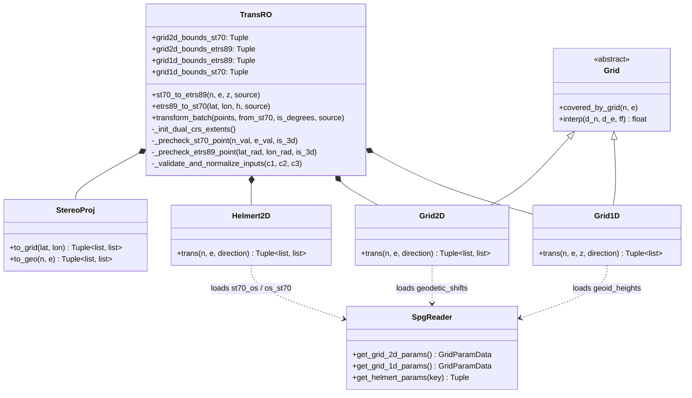
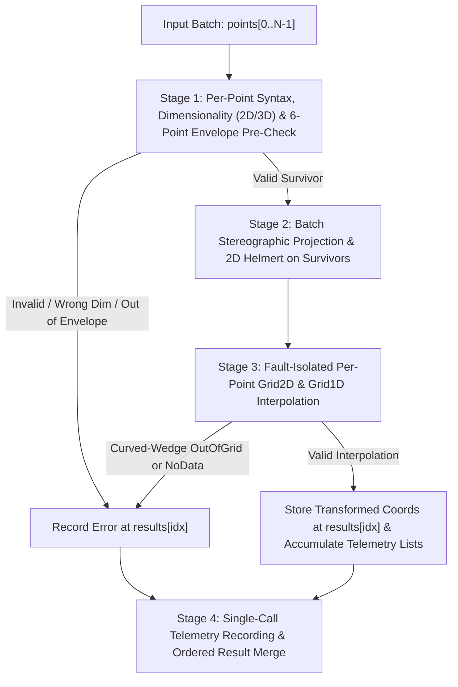

# Core Geodetic Computation Engine (`pytransdatro/`)

## 1. Overview & Architectural Invariants

The `pytransdatro` package is the foundational geodetic computation engine of **PyTransDatRO**. It executes bidirectional 2D and 3D coordinate transformations between **Stereo70** (Dealul Piscului 1970 / Pulkovo 1942(58) Oblique Stereographic, `EPSG:31700`) and **ETRS89** (European Terrestrial Reference System 1989 / GRS80, `EPSG:4258`), including vertical height transformations between **Marea Neagră 1975 (MN75)** normal heights ($H$) and **ETRS89** ellipsoidal heights ($h$).

### Core Design Invariants
1. **Pure Python Standard Library Processing**: All mathematical projections, Helmert transformations, bicubic/bilinear grid interpolations, and coordinate validations are implemented strictly in pure Python (`math`, `typing`, `logging`, `pathlib`).
2. **Strict NumPy Isolation**: `numpy` is used **exclusively** inside [`SpgReader`](../pytransdatro/spg_reader.py) to unpickle the binary `.spg` grid package and extract flat Python `tolist()` arrays at startup.
3. **Zero Web Layer Coupling**: `pytransdatro/` never imports from `api/`, `fastapi`, `pydantic`, or any web framework, allowing the package to be used as a standalone scientific library or CLI tool.
4. **Byte-for-Byte RomGEO Fidelity**: Numerical outputs match the official ANCPI / CNC **RomGEO** desktop reference implementation within machine epsilon ($< 10^{-9}$ tolerance across all 9,046 national control points).

---

## 2. Module & Component Architecture

| Module | Primary Classes / Functions | Responsibility |
| :--- | :--- | :--- |
| [`pytransdatro/trans_ro.py`](../pytransdatro/trans_ro.py) | `TransRO` | Main coordinator orchestrating single-point, vectorized sequence, and 4-stage fault-isolated batch transformations (`st70_to_etrs89`, `etrs89_to_st70`, `transform_batch`), dual-CRS 6-point extended bounding box pre-checks, and telemetry hooks. |
| [`pytransdatro/proj_stereo.py`](../pytransdatro/proj_stereo.py) | `StereoProj`, `_Ellipsoid`, `_ConfSph` | Forward (`to_grid`) and inverse (`to_geo`) Oblique Stereographic projection between geographic coordinates $(\varphi, \lambda)$ and planar grid coordinates $(N, E)$ via the Gaussian conformal sphere. |
| [`pytransdatro/trans_helmert2d.py`](../pytransdatro/trans_helmert2d.py) | `Helmert2D` | 4-parameter 2D Helmert conformal transformation ($t_N, t_E, ds, R_z$) between Stereo70 and StereoGRS80 planar coordinates, dynamically parameterized from `.spg` metadata. |
| [`pytransdatro/trans_grid.py`](../pytransdatro/trans_grid.py) | `Grid`, `BiInterp`, `Grid2D`, `Grid1D` | Grid boundary verification (`covered_by_grid`), 16-coefficient bicubic spline (`_trans_bicubic`), bilinear (`_trans_bilinear`), and nearest-neighbor (`_trans_colocate`) grid shift interpolation for 2D planimetric distortions (`geodetic_shifts`) and 1D quasigeoid undulations (`geoid_heights`). |
| [`pytransdatro/spg_reader.py`](../pytransdatro/spg_reader.py) | `SpgReader`, `GridParamData` | Auto-discovers, validates, and deserializes the active `.spg` binary grid file in `pytransdatro/grids/`, computing true array extents directly from matrix dimensions. |
| [`pytransdatro/utils.py`](../pytransdatro/utils.py) | `sexa_to_rad`, `sexa_dms_chars_to_rad`, `format_rad_to_dms`, `rad_to_sexa` | Angle unit conversions, strict sexagesimal DMS parsing with cardinal indicator validation (`N`, `E`, `S`, `W`, `V`), and precision-safe DMS formatting with 60-second rollover. |
| [`pytransdatro/constants.py`](../pytransdatro/constants.py) | Geodetic & Grid Constants | Immutable ellipsoid parameters, Stereo70 projection origins, conformal sphere constants, and grid No-Data sentinel thresholds (`999.0`). |
| [`pytransdatro/exceptions.py`](../pytransdatro/exceptions.py) | `PyTransDatError` hierarchy | Structured domain exceptions for invalid coordinates, wrong dimensionality, 2D/1D out-of-grid bounds, and No-Data grid cells. |



---

## 3. Mathematical Transformation Pipelines

Notice the asymmetric placement of the 2D planimetric grid shift (`Grid2D`): because the `geodetic_shifts` grid is indexed in **Stereo70 meters**, it is applied **first** during `Stereo70 -> ETRS89` and **last** (after projecting and inverse-Helmert shifting) during `ETRS89 -> Stereo70`.Conversely, the 1D quasigeoid grid (`Grid1D`) is indexed in **ETRS89 decimal degrees**, so it always evaluates at the ETRS89 geographic coordinates.

### 3.1. Stereo70 to ETRS89 (`TransRO.st70_to_etrs89`)

**Inputs**: Northing $N$ ($\text{m}$), Easting $E$ ($\text{m}$), and optional normal height $H_{\text{MN75}}$ ($\text{m}$).

1. **Input & 6-Point Extended Bounding Box Pre-Check**:
   - Validates finite numeric inputs and checks $(N, E)$ against `grid2d_bounds_st70` (and `grid1d_bounds_st70` when $H$ is provided).
2. **2D Planimetric Distortion Grid Shift (Inverse, `direction = -1`)**:
   - Evaluates bicubic spline interpolation on `geodetic_shifts` at $(N, E)$ to obtain local shifts $(\Delta N_{\text{grid}}, \Delta E_{\text{grid}})$ and subtracts them:
     $$N' = N - \Delta N_{\text{grid}}(N, E), \quad E' = E - \Delta E_{\text{grid}}(N, E)$$
3. **2D Helmert Transformation (Forward, `direction = +1`)**:
   - Transforms Dealul Piscului 1970 planar coordinates $(N', E')$ to StereoGRS80 planar coordinates $(N_{\text{GRS80}}, E_{\text{GRS80}})$ using parameters $(t_N, t_E, ds, R_z)$ from `.spg` metadata (`st70_os`):
     $$m = 1 + ds \cdot 10^{-6}$$
     $$\begin{bmatrix} E_{\text{GRS80}} \\ N_{\text{GRS80}} \end{bmatrix} = \begin{bmatrix} t_E \\ t_N \end{bmatrix} + m \begin{bmatrix} \cos R_z & \sin R_z \\ -\sin R_z & \cos R_z \end{bmatrix} \begin{bmatrix} E' \\ N' \end{bmatrix}$$
4. **Inverse Oblique Stereographic Projection (`StereoProj.to_geo`)**:
   - Projects $(N_{\text{GRS80}}, E_{\text{GRS80}})$ from the flat projection plane onto the Gaussian conformal sphere of radius $R = \sqrt{M_0 N_0}$ centered at $(\varphi_0 = 46^\circ\text{ N}, \lambda_0 = 25^\circ\text{ E})$ with scale factor $k_0 = 0.99975$ and false origin $N_0 = E_0 = 500,000\text{ m}$, then iteratively solves for geodetic latitude $\varphi$ and longitude $\lambda$ (in radians) on the GRS80/WGS84 ellipsoid.
5. **1D Quasigeoid Undulation Correction (Optional 3D, `direction = +1`)**:
   - When $H_{\text{MN75}}$ is supplied, converts $(\varphi, \lambda)$ to decimal degrees, interpolates the quasigeoid undulation $\zeta(\varphi^\circ, \lambda^\circ)$ from `geoid_heights`, and adds it to obtain ellipsoidal height $h$:
     $$h_{\text{ETRS89}} = H_{\text{MN75}} + \zeta(\varphi^\circ, \lambda^\circ)$$

**Outputs**: $(\varphi, \lambda[, h_{\text{ETRS89}}])$ with $\varphi, \lambda$ in radians and $h$ in meters.

---

### 3.2. ETRS89 to Stereo70 (`TransRO.etrs89_to_st70`)

**Inputs**: Latitude $\varphi$ ($\text{rad}$), Longitude $\lambda$ ($\text{rad}$), and optional ellipsoidal height $h_{\text{ETRS89}}$ ($\text{m}$).

1. **Input & 6-Point Extended Bounding Box Pre-Check**:
   - Validates finite numeric inputs and checks $(\varphi, \lambda)$ against `grid2d_bounds_etrs89` (and `grid1d_bounds_etrs89` when $h$ is provided). This immediately blocks out-of-envelope coordinates, pole singularities ($\varphi = \pm 90^\circ$), and $2\pi$ periodic radian aliasing before trigonometric projection.
2. **Forward Oblique Stereographic Projection (`StereoProj.to_grid`)**:
   - Converts geodetic $(\varphi, \lambda)$ to conformal sphere coordinates $(\chi, \lambda_c)$ and projects them to StereoGRS80 planar coordinates $(N_{\text{GRS80}}, E_{\text{GRS80}})$:
     $$b = 1 + \sin\chi \sin\chi_0 + \cos\chi \cos\chi_0 \cos(\lambda_c - \lambda_0)$$
     $$N_{\text{GRS80}} = N_0 + \frac{2 R k_0}{b}\big(\sin\chi \cos\chi_0 - \cos\chi \sin\chi_0 \cos(\lambda_c - \lambda_0)\big)$$
     $$E_{\text{GRS80}} = E_0 + \frac{2 R k_0}{b}\big(\cos\chi \sin(\lambda_c - \lambda_0)\big)$$
3. **2D Helmert Transformation (Inverse, `direction = -1`)**:
   - Applies the inverse Helmert transformation (`os_st70`) to obtain intermediate Stereo70 coordinates $(N', E')$.
4. **2D Planimetric Distortion Grid Shift (Forward, `direction = +1`)**:
   - Checks exact Stereo70 grid coverage (`Grid2D.covered_by_grid`), evaluates bicubic spline interpolation on `geodetic_shifts` at $(N', E')$, and adds the shifts:
     $$N = N' + \Delta N_{\text{grid}}(N', E'), \quad E = E' + \Delta E_{\text{grid}}(N', E')$$
5. **1D Quasigeoid Undulation Correction (Optional 3D, `direction = -1`)**:
   - When $h_{\text{ETRS89}}$ is supplied, evaluates `geoid_heights` at the input $(\varphi^\circ, \lambda^\circ)$ and subtracts the quasigeoid undulation:
     $$H_{\text{MN75}} = h_{\text{ETRS89}} - \zeta(\varphi^\circ, \lambda^\circ)$$

**Outputs**: $(N, E[, H_{\text{MN75}}])$ in meters.

---

### 3.3. Grid Interpolation Methods (`trans_grid.py`)

Both `Grid2D` and `Grid1D` dynamically bind their interpolation method from the `.spg` metadata header (`interpolation_method_id`):
- **Bicubic Spline (`method_id = 2`, default for `Grid2D` and `Grid1D` in `rom_grid3d_25.09.spg`)**:
  - Extracts a $4 \times 4$ neighborhood of 16 surrounding grid nodes around the normalized cell offset $(\delta_N, \delta_E) \in [0, 1]^2$.
  - If any of the 16 nodes is `NaN` or equals the No-Data sentinel (`999.0`), raises `NoDataGridErr`.
  - Multiplies the 16-element node vector by the precomputed $16 \times 16$ Catmull-Rom / bicubic spline basis matrix (`BiInterp._C`) to evaluate the 2D cubic polynomial:
    $$f(\delta_N, \delta_E) = \sum_{i=0}^{3} \sum_{j=0}^{3} a_{ij} \, \delta_N^i \, \delta_E^j$$
- **Bilinear (`method_id = 1`)**: Evaluates the 4-node cell weighted average over $(1 - \delta_N)(1 - \delta_E)$.
- **Nearest-Neighbor Colocation (`method_id = 0`)**: Rounds to the nearest grid node index $(i_r, j_c)$.

---

## 4. Multi-Stage Spatial & Semantic Validation

### 4.1. Why a 4-Corner Bounding Box Fails: Conformal Curvature
In `TransRO`, the 2D planimetric grid (`geodetic_shifts`) is a rectangle in **Stereo70 meters** ($N \in [212,000, \, 784,000]\text{ m}$, $E \in [102,000, \, 894,000]\text{ m}$), whereas the 1D geoid grid (`geoid_heights`) is a rectangle in **ETRS89 degrees** ($\varphi \in [43.50^\circ, \, 48.40^\circ\text{ N}]$, $\lambda \in [20.00^\circ, \, 29.80^\circ\text{ E}]$).

Because the Oblique Stereographic projection is centered at $(\varphi_0 = 46^\circ\text{ N}, \lambda_0 = 25^\circ\text{ E} \leftrightarrow E_0 = 500,000\text{ m})$:
- **North and South Borders Curve Vertically**: Lines of constant latitude are concentric circles around the North Pole. On the Stereo70 plane, a parallel of constant latitude curves upward at the East/West corners and dips **southward** at the central meridian ($\lambda_0 = 25^\circ\text{ E}$). Conversely, a straight horizontal line of constant Stereo70 Northing bows **northward** at the central meridian:
  - Along the northern border of `Grid2D` ($N = 783,000\text{ m}$), the NW and NE corners have latitude $\varphi \approx 48.4620^\circ\text{ N}$, but the **North midpoint** at $E_0 = 500,000\text{ m}$ reaches $\varphi \approx 48.5458^\circ\text{ N}$ ($\sim 9.3\text{ km}$ further North!).
  - Along the southern border of `Grid1D` ($\varphi = 43.50^\circ\text{ N}$), the SW and SE corners have Stereo70 Northing $N \approx 228,154\text{ m}$ and $226,419\text{ m}$, but the **South midpoint** at $\lambda_0 = 25^\circ\text{ E}$ dips down to $N \approx 222,226\text{ m}$ ($\sim 4.2\text{ km}$ further South!).
- **East and West Borders Tilt Monotonically**: Meridians converge continuously from South to North without bending back across $46^\circ\text{ N}$. Therefore, the 4 corners already capture 100% of the East/West extremes (Northern corners for maximum longitude span of `Grid2D`; Southern corners for maximum Easting span of `Grid1D`).

### 4.2. The 6-Point Extended Dual-CRS Bounding Envelope
At initialization, [`TransRO._init_dual_crs_extents()`](../pytransdatro/trans_ro.py) projects **6 boundary points** for each grid into the opposite CRS:
1. **Southwest Corner**
2. **Northwest Corner**
3. **Southeast Corner**
4. **Northeast Corner**
5. **South Midpoint** (at $E_0 = 500,000\text{ m}$ for `Grid2D`, or $\lambda_0 = 25^\circ\text{ E}$ for `Grid1D`)
6. **North Midpoint** (at $E_0 = 500,000\text{ m}$ for `Grid2D`, or $\lambda_0 = 25^\circ\text{ E}$ for `Grid1D`)

Taking the minimum and maximum across these 6 points produces a mathematically guaranteed outer bounding box in both CRSs (`grid2d_bounds_st70`, `grid2d_bounds_etrs89`, `grid1d_bounds_etrs89`, `grid1d_bounds_st70`):

| Spatial Region of Input Point | Stage Caught | Exception Raised |
| :--- | :--- | :--- |
| **1. Outside the 6-Point Extended Envelope** | Caught immediately at entry (`_precheck_st70_point` / `_precheck_etrs89_point`) before any projection or Helmert math. | `OutOfGrid2DErr` (or `OutOfGrid1DErr` if 3D point is inside 2D box but outside 1D geoid box) |
| **2. Inside Extended Envelope, but inside the "Curved Border Wedge"** | Passes pre-check, projects into native grid CRS, and is caught at entry to `Grid2D.covered_by_grid` or `Grid1D.covered_by_grid`. | `OutOfGrid2DErr` or `OutOfGrid1DErr` |
| **3. Inside Native Grid Rectangle, but outside Romania's Border Buffer** | Passes `covered_by_grid`, caught when surrounding $4 \times 4$ or $2 \times 2$ grid nodes contain `999.0` / `NaN`. | `NoDataGridErr` |

---

## 5. Fault-Isolated Batch Pipeline (`TransRO.transform_batch`)

When processing an array of coordinates (e.g., from `POST /api/v1/transform/batch` or Legacy `POST /transdatonline/cooOpService`), [`TransRO.transform_batch()`](../pytransdatro/trans_ro.py) ensures that a single malformed, out-of-grid, or No-Data coordinate never aborts the batch, while still executing vectorized projection/Helmert math and recording a single aggregated telemetry event:



1. **Stage 1 (Pre-Filtering)**: Iterates over `points`, isolating non-list items, non-numeric/`NaN`/`Inf`/`bool` values (`InvalidCoordinateErr`), 1D or $\ge 4$D rows (`WrongDimensionErr`), and points outside the 6-point extended bounding box (`OutOfGrid2DErr` / `OutOfGrid1DErr`). Valid survivors are packed into contiguous coordinate arrays alongside their original indices `surv_idxs`.
2. **Stage 2 (Vectorized Projection & Helmert)**: Projects and Helmert-shifts all surviving coordinates together in a single vectorized pass.
3. **Stage 3 (Fault-Isolated Grid Interpolation)**: Evaluates `Grid2D` and (for 3D points) `Grid1D` per survivor inside a targeted `try / except (OutOfGridErr, NoDataGridErr)` block so points falling inside a curved border wedge or a No-Data border cell are isolated to their own index `results[orig_idx]`.
4. **Stage 4 (Single-Call Telemetry & Merge)**: Calls `self._collector.record(...)` once for all valid 2D points and once for all valid 3D points in the batch (`1 call, K valid points`), returning `list[Tuple[list[float], Optional[PyTransDatError]]]` in exact input order.

---

## 6. Domain Exception Hierarchy (`pytransdatro/exceptions.py`)

| Exception Class | Base Class(es) | Trigger Condition |
| :--- | :--- | :--- |
| **`PyTransDatError`** | `Exception` | Base class for all domain exceptions raised by `pytransdatro`. |
| **`InvalidCoordinateErr`** | `ValueError`, `PyTransDatError` | Non-numeric coordinate, `NaN`, `Infinity`, boolean, pole singularity ($\|\varphi\| \ge \pi/2$), or malformed DMS string ($m \ge 60$, $s \ge 60$, conflicting signs/cardinals, fractional degrees/minutes with sub-units). |
| **`WrongDimensionErr`** | `ValueError`, `PyTransDatError` | Empty coordinate sequence, mismatched sequence lengths across `(n, e, z)`, mixed scalar/sequence arguments, or point tuple with $<2$ or $>3$ coordinates. |
| **`OutOfGridErr`** | `ValueError`, `PyTransDatError` | Base class for coordinates outside the bounding extent of a transformation grid. Stores `.n`, `.e`, and `.grid` attributes. |
| **`OutOfGrid2DErr`** | `OutOfGridErr` | Coordinate lies outside the 2D planimetric distortion grid (`geodetic_shifts`). |
| **`OutOfGrid1DErr`** | `OutOfGridErr` | 3D coordinate lies outside the 1D quasigeoid height grid (`geoid_heights`). |
| **`NoDataGridErr`** | `ValueError`, `PyTransDatError` | Coordinate is inside the grid rectangle, but one or more surrounding interpolation nodes contain the `999.0` / `NaN` No-Data sentinel (outside Romania's border buffer). |
| **`GridError`** | `RuntimeError`, `PyTransDatError` | Base class for `.spg` grid file discovery or loading failures. |
| **`MissingGridError`** | `FileNotFoundError`, `GridError` | No `.spg` grid file found in `pytransdatro/grids/`. |
| **`AmbiguousGridError`** | `GridError` | Multiple `.spg` grid files found in `pytransdatro/grids/` without an explicit path override. |

---

## 7. Python Library Usage Examples

### 7.1. Scalar & Vectorized Sequence Transformations
```python
import math
from pytransdatro import TransRO

engine = TransRO()

# 1. Single 3D point: Stereo70 (N, E, H_MN75) -> ETRS89 (lat_rad, lon_rad, h)
lat_rad, lon_rad, h = engine.st70_to_etrs89(500000.0, 500000.0, 100.0)
print(math.degrees(lat_rad), math.degrees(lon_rad), round(h, 4))
# -> 45.9997186280 24.9984476351 139.6084

# 2. Vectorized sequence of 2D points: ETRS89 (radians) -> Stereo70 (meters)
n_list, e_list = engine.etrs89_to_st70(
    [math.radians(46.0), math.radians(45.5)],
    [math.radians(25.0), math.radians(24.5)],
)
```

### 7.2. Fault-Isolated Batch Transformation
```python
batch_points = [
    [500000.0, 500000.0, 100.0],  # Valid 3D point
    [5.0, 1.0, 100.0],            # Outside grid -> OutOfGrid2DErr
    [549364.0, 147553.0, 100.0],  # Outside border -> NoDataGridErr
    [510000.0, 510000.0],         # Valid 2D point
]

results = engine.transform_batch(batch_points, from_st70=True)
for coords, err in results:
    if err is None:
        print("Transformed:", coords)
    else:
        print("Failed point:", coords, "Reason:", type(err).__name__, "-", err)
```

### 7.3. Sexagesimal DMS Parsing & Formatting
```python
from pytransdatro import utils

# Parse DMS string with cardinal direction to radians
lat_rad = utils.sexa_dms_chars_to_rad("46°00'00.00000\"N")

# Format radians back to canonical DMS string
dms_str = utils.format_rad_to_dms(lat_rad, precision=5)
print(dms_str)  # -> 46°00'00.00000"
```
