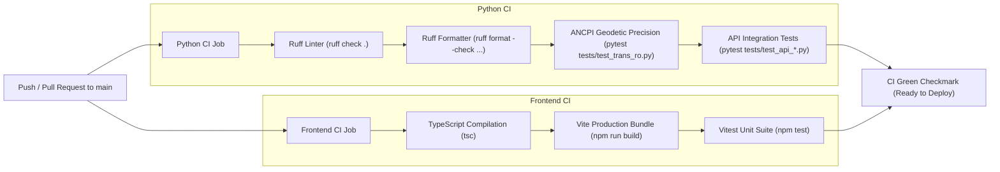

# Deployment & Infrastructure Architecture

## Overview
PyTransDatRO is deployed using a production-ready, **environment-agnostic 2-container architecture** orchestrated via Docker Compose. The system is designed under the **12-Factor App** methodology, separating generic, version-controlled application code from host-specific operational configuration.

This ensures that the repository contains zero hardcoded IP addresses, domains, or server paths, allowing any organization, developer, or community to deploy PyTransDatRO on their own infrastructure (cloud VM, on-premises server, or local workstation) with zero code modifications.

```
[ Public Users / Surveyors / Desktop CLI ]
                      │
                      ▼ Host Port (Default: 8000, configurable via WEBAPP_PORT)
┌────────────────────────────────────────────────────────────────────────┐
│ Container 1: Web App & Reverse Proxy (web)                             │
│ - Base Image: nginx:alpine (Multi-stage build from webapp/)            │
│ - Serves pre-compiled Vite + TypeScript static assets                  │
│ - Proxies /api/*, /docs, /openapi.json to Backend                     │
│ - Client IP header preservation (X-Forwarded-For, X-Real-IP)           │
│ - 50 MB request body limit for batch/file transformations              │
│ - Gzip compression & immutable asset caching                           │
└────────────────────────────────┬───────────────────────────────────────┘
                                 │
                                 │ Internal Docker Bridge Network (http://backend:8000)
                                 │ (Healthcheck synchronized startup)
                                 ▼
┌────────────────────────────────────────────────────────────────────────┐
│ Container 2: Backend REST API & Engine (backend)                       │
│ - Base Image: python:3.11-slim (FastAPI + Uvicorn)                     │
│ - In-Memory Pure Python Geodetic Engine (pytransdatro)                 │
│ - Non-blocking SQLite WAL Telemetry Logger                             │
│ - Healthcheck: GET /health verifies grid pre-warming & telemetry       │
└────────────────────────────────┬───────────────────────────────────────┘
                                 │
                                 ▼ Persistent Host Mount
                 ┌──────────────────────────────────────┐
                 │ Host Volume Directory (./logs)       │
                 │ Mounted to: /app/logs                │
                 │ - usage.db (auto-created on startup) │
                 │ - legacy_stats.db (seeded via SCP)   │
                 │ - feedback.log                       │
                 └──────────────────────────────────────┘
```

---

## 1. Core Architectural Invariants

### 1.1 Universal Environment Agnosticism
- **Zero Environment Data in Git:** The codebase, container files, and repository configuration contain no machine-specific paths, private IP addresses, or fixed domain names.
- **Configuration Isolation via Untracked `.env`:** All deployment-specific overrides (such as host ports or log locations) live exclusively in an untracked `.env` file on the physical server host.
- **Portability:** Running `docker compose up -d` on any machine boots the full stack with sensible defaults (`port 8000`).

### 1.2 Upstream / Downstream Multi-Repository Governance (GitHub Fork Model)
- **Upstream ([`bogdanmorosanu/PyTransDatRO`](https://github.com/bogdanmorosanu/PyTransDatRO)):** The sovereign open-source repository under the MIT License where active development, benchmarking, and core algorithms evolve.
- **Downstream Forks (e.g., Community Hosting):** Organizations hosting community instances maintain an official GitHub Fork.
- **Clean 1-Click Sync:** Because downstream forks contain zero environment-specific files, pulling releases from upstream is always an instant, conflict-free fast-forward merge.

### 1.3 Clean Domain-Root Web Architecture
- PyTransDatRO serves strictly from the root path (`/`) of its assigned virtual host or domain (e.g. `https://transdat.example.org/` or `http://localhost:8000/`).
- Outer reverse proxies (Nginx, Traefik, HAProxy, Cloudflare) must route the dedicated domain directly to the web container's exposed port. No subpath rewrites (e.g. `/pytransdat`) are permitted in the application codebase.

---

## 2. Container Topology & Roles

### 2.1 Web Container (`web`)
- **Docker Recipe:** [`Dockerfile.web`](../Dockerfile.web)
  - *Stage 1 (Node 20 Alpine):* Compiles TypeScript and packages the production bundle via `npm run build` targeting `webapp/`.
  - *Stage 2 (Nginx Alpine):* Strips default Nginx assets and installs the compiled distribution into `/usr/share/nginx/html` with custom [`nginx.conf`](../nginx.conf).
- **Reverse Proxy Routing:**
  - `/` $\to$ Serves SPA static bundle with `try_files $uri $uri/ /index.html;`.
  - `/api/*`, `/docs`, `/redoc`, `/openapi.json`, `/health`, `/cooOpService`, `/transdatonline/*` $\to$ Forwarded to `http://backend:8000`.
- **Client IP Preservation:**
  FastAPI's sliding-window rate limiter relies on the `X-Forwarded-For` header. Nginx explicitly injects:
  ```nginx
  proxy_set_header Host $host;
  proxy_set_header X-Real-IP $remote_addr;
  proxy_set_header X-Forwarded-For $proxy_add_x_forwarded_for;
  proxy_set_header X-Forwarded-Proto $scheme;
  ```
  Without these headers, all requests would appear to originate from Nginx's internal container IP (`172.18.0.x`), causing all global users to share a single rate-limit bucket.
- **Throughput & Upload Caps:** `client_max_body_size 50M;` matches the backend maximum streaming file upload threshold (`PYTRANSDAT_MAX_FILE_UPLOAD_BYTES`).

### 2.2 Backend Container (`backend`)
- **Docker Recipe:** [`Dockerfile`](../Dockerfile)
  - Base: `python:3.11-slim`.
  - Installs production dependencies from `requirements.txt` and `requirements-api.txt`.
  - Copies core geodetic library `pytransdatro/` (including binary `.spg` grids) and API layer `api/`.
- **In-Memory Geodetic Execution:** Mathematical transformations execute entirely in-process without network serialization overhead between the API and the geodetic library.
- **Healthcheck & Startup Synchronization:**
  The binary grid reader pre-warms on startup. The container exposes an internal healthcheck:
  ```dockerfile
  HEALTHCHECK --interval=15s --timeout=5s --start-period=5s --retries=3 \
      CMD python -c "import urllib.request; urllib.request.urlopen('http://localhost:8000/health')" || exit 1
  ```
  In [`docker-compose.yml`](../docker-compose.yml), the `web` container declares `depends_on: { backend: { condition: service_healthy } }`, ensuring public web traffic is routed only after grid deserialization succeeds.

---

## 3. Persistent Storage & SQLite WAL Safety

The backend container mounts the host directory `./logs` to `/app/logs`:

| Database / File | Lifecycle | Handling |
| :--- | :--- | :--- |
| **`usage.db`** | Auto-created on startup | Active SQLite telemetry database running in Write-Ahead Logging (`WAL`) mode with automatic aggregation. |
| **`legacy_stats.db`** | Seeded once via SCP/SFTP | Read-only historical usage database extracted from legacy TransDatOnline MySQL dumps. Ignored in Git. |
| **`feedback.log`** | Auto-created on submission | Append-only JSON-lines log for user feedback submissions. |

### 3.1 Non-Blocking SQLite Live Backup
In WAL mode, raw file copying (`cp usage.db backup.db`) can capture incomplete or corrupt states during active write transactions. To safely backup the live database without service interruption:
```bash
docker compose exec backend python -c "import sqlite3; conn = sqlite3.connect('/app/logs/usage.db'); conn.execute('PRAGMA wal_checkpoint(TRUNCATE);'); backup = sqlite3.connect('/app/logs/usage_backup.db'); conn.backup(backup); conn.close(); backup.close()"
```

---

## 4. Configuration Reference (`.env.example`)

All configuration knobs are centrally defined and documented in [`.env.example`](../.env.example):

```env
# Host port mapped to Nginx web container (default: 8000 locally, 80 or 8080 on production)
WEBAPP_PORT=8000

# Backend service configuration
PYTRANSDAT_HOST=0.0.0.0
PYTRANSDAT_PORT=8000
PYTRANSDAT_LOG_LEVEL=INFO
PYTRANSDAT_CORS_ORIGINS=["*"]
PYTRANSDAT_RATE_LIMIT_WINDOW_SECONDS=60.0
PYTRANSDAT_RATE_LIMIT_POINT=60
PYTRANSDAT_RATE_LIMIT_BATCH=10
PYTRANSDAT_MAX_BATCH_POINTS=20000
PYTRANSDAT_MAX_FILE_POINTS=100000
PYTRANSDAT_MAX_FILE_UPLOAD_BYTES=52428800
PYTRANSDAT_LOG_DIR=./logs
PYTRANSDAT_LEGACY_DB_PATH=./logs/legacy_stats.db
PYTRANSDAT_FEEDBACK_LOG_PATH=./logs/feedback.jsonl
PYTRANSDAT_TELEMETRY_FALLBACK_PATH=./logs/telemetry_fallback.jsonl
PYTRANSDAT_APP_LOG_ENABLED=true
PYTRANSDAT_APP_LOG_PATH=./logs/app.log
PYTRANSDAT_APP_LOG_MAX_BYTES=10485760
PYTRANSDAT_APP_LOG_BACKUP_COUNT=5
```

---

## 5. Continuous Integration (CI) Automation

The automated GitHub Actions workflow ([`.github/workflows/ci.yml`](../.github/workflows/ci.yml)) triggers on every push and Pull Request to `main`:



---

## 6. Operational Runbook

### 6.1 First-Time Server Setup
```bash
# 1. Clone repository to server
git clone <repo-url> /opt/pytransdatro
cd /opt/pytransdatro

# 2. Configure local environment
cp .env.example .env
# Edit .env to set desired WEBAPP_PORT (e.g., WEBAPP_PORT=80 or 8080)

# 3. Create persistent logs directory and seed historical data
mkdir -p logs
# Copy legacy_stats.db to ./logs/ if historical statistics are required

# 4. Launch container stack
docker compose up -d --build
```

### 6.2 Upgrading to a New Release (Zero-Downtime Swap)
```bash
cd /opt/pytransdatro
git pull origin main
docker compose up -d --build
```
*Docker builds the updated images, checks health status on the new backend, swaps the running containers, and leaves the `./logs` volume untouched.*

### 6.3 Log Management & Disk Protection
Both containers enforce Docker JSON log rotation in [`docker-compose.yml`](../docker-compose.yml):
```yaml
logging:
  driver: "json-file"
  options:
    max-size: "10m"
    max-file: "3"
```
This guarantees container stdout/stderr logs will never exceed 30 MB on the host disk partition.
