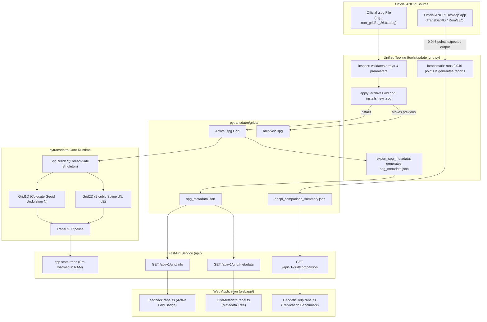

# Official ANCPI SPG Grid Update & Lifecycle Management

This document provides a comprehensive architectural explanation and operational procedure for updating the official Romanian geodetic transformation grid (`.spg` format) in **PyTransDatRO**.

When the **Centrul Național de Cartografie (CNC)** / **Agenția Națională de Cadastru și Publicitate Imobiliară (ANCPI)** publishes an updated binary grid file (such as a future `rom_grid3d_YY.MM.spg`), this guide explains what happens behind the scenes in code and provides the exact procedure for applying the new grid, updating official benchmark test data, synchronizing metadata, and verifying zero regressions.

---

## 1. Core Architectural Concepts & Invariants

PyTransDatRO utilizes a **unified 3D binary grid model** (`.spg`) containing both 2D planimetric distortion shifts (ETRS89 $\leftrightarrow$ Stereo 70) and 1D vertical quasigeoid undulations (Black Sea 1975 normal heights).

### Key Architectural Invariants:
1. **Single Active Grid Invariant**:
   - The directory [`pytransdatro/grids/`](../pytransdatro/grids/) must contain **exactly one** `.spg` file.
   - If multiple `.spg` files are present, [`SpgReader`](../pytransdatro/spg_reader.py) raises an [`AmbiguousGridError`](../pytransdatro/exceptions.py) to prevent accidental non-deterministic transformation results.
   - Previous grids are archived in [`pytransdatro/grids/archive/`](../pytransdatro/grids/archive/).
2. **Pure Python Processing Invariant**:
   - The core geodetic engine ([`pytransdatro/`](../pytransdatro/)) is implemented in pure Python (standard library only).
   - **Exception**: `numpy` is permitted **strictly** for loading and unpickling the binary grid file into memory at initialization. All coordinate transformations, interpolations, and Helmert computations execute in pure Python.
3. **Zero Remnants & Dynamic Reflection**:
   - When a new grid is deployed, all metadata, layer extents, Helmert parameters, and benchmark statistics must reflect the new grid dynamically across the REST API ([`api/`](../api/)) and Web Application ([`webapp/`](../webapp/)), leaving no stale information from older grids.

---

## 2. Behind the Scenes: Code Lifecycle & Data Flow

Understanding how a grid file traverses the system is essential for troubleshooting and operations:



### Detailed Execution Steps Under the Hood:

1. **Discovery & Unpickling (`SpgReader`)**:
   - At startup, [`pytransdatro.spg_reader.SpgReader`](../pytransdatro/spg_reader.py) globs [`pytransdatro/grids/*.spg`](../pytransdatro/grids/).
   - It reads the NumPy dictionary, extracts the parameters (`params`), metadata (`metadata`), and grid arrays (`grids`).
   - It converts planar shift arrays and quasigeoid rasters into flat Python tuples (`shift_e_flat`, `shift_n_flat`, `height_flat`) and caches the 2D Helmert parameters.
2. **Server State Pre-Warming (`api/main.py`)**:
   - The FastAPI lifespan hook initializes `TransRO(telemetry_logger=telemetry)` and binds it to `app.state.trans`.
   - > [!IMPORTANT]
     > The running Uvicorn server holds the deserialized grid in RAM. Simply overwriting the file on disk will not update live transformations in an active process; the Python server must be restarted or reloaded.
3. **Metadata Caching & Dynamic Validation (`api/routes/info.py`)**:
   - `/api/v1/grid/metadata` reads [`pytransdatro/grids/spg_metadata.json`](../pytransdatro/grids/spg_metadata.json).
   - If the pre-rendered JSON is missing or its recorded file name does not match the active `.spg` file on disk, `_load_or_extract_metadata()` automatically re-extracts full metadata dynamically and saves it.
4. **Replication Metrics (`api/routes/info.py`)**:
   - `/api/v1/grid/comparison` reads [`pytransdatro/grids/ancpi_comparison_summary.json`](../pytransdatro/grids/ancpi_comparison_summary.json).
   - Returns the active benchmarked grid file, version, SHA-256, overall status (`PASS`), and residual distributions.
5. **Web Application Display**:
   - **Grid Metadata Panel** (`GridMetadataPanel.ts`): Queries `/api/v1/grid/metadata` to render the tree view, Helmert matrices, and band statistics.
   - **Geodetic Help Panel** (`GeodeticHelpPanel.ts`): Queries `/api/v1/grid/comparison` to display the national control point replication table. If the active grid differs from the benchmark baseline, it displays an informative notice.

---

## 3. The Ground Truth Reality: Why Test Data Must Be Updated

PyTransDatRO guarantees zero functional regression against official ANCPI results. It achieves this by validating coordinate transformations against **9,046 national control points** spread across all 41 counties of Romania.

The benchmark datasets reside in [`tests/data/`](../tests/data/):
- **Inputs**:
  - `etrs89_to_st70_input.csv` (9,046 points: $\phi, \lambda, h$ in DMS / sexagesimal)
  - `st70_to_etrs89_input.csv` (9,046 points: $X, Y, H$ in meters)
- **Expected Outputs (Official ANCPI Ground Truth)**:
  - `etrs89_to_st70_expected.csv` (9,046 points: $X, Y, H$ in meters)
  - `st70_to_etrs89_expected.csv` (9,046 points: $\phi, \lambda, h$ in DMS / sexagesimal)

> [!WARNING]
> ### Critical Dependency on Official Reference Data
> When ANCPI publishes a new `.spg` grid, the internal mathematical shift values ($dN, dE$) or quasigeoid undulations ($N$) change for portions of the country.
>
> If you update the `.spg` grid file **without** updating `*_expected.csv`:
> 1. Running [`pytest tests/test_trans_ro.py`](../tests/test_trans_ro.py) will **FAIL** because PyTransDatRO (using the new grid) will calculate coordinates that differ from the old expected values by more than the allowed $0.001\text{ m}$ tolerance.
> 2. Running `update_grid.py benchmark` will calculate high residuals and report an overall status of **FAIL**.
>
> **Therefore, updating the test data (`tests/data/*_expected.csv`) with the official ANCPI results for the new grid is mandatory before the benchmark will PASS.**

---

## 4. Unified Grid Tool: `tools/update_grid.py`

All operational actions are centralized in [`tools/update_grid.py`](../tools/update_grid.py):

```bash
# Display help and available subcommands
python tools/update_grid.py --help
```

### Subcommands Overview:

| Subcommand | Description | Safety / Side Effects |
|---|---|---|
| **`status`** | Audits current active grid, metadata JSON freshness, benchmark alignment, and test data timestamps. | Read-only. Safe to run anytime. |
| **`inspect <file.spg>`** | Parses and validates a candidate `.spg` file; checks layers, Helmert parameters, and displays comparison against active grid. | Read-only. Safe to run anytime. |
| **`apply <file.spg>`** | Moves current grid to `pytransdatro/grids/archive/`, installs new grid, regenerates `spg_metadata.json`, and audits web bounds. | Modifies `pytransdatro/grids/`. |
| **`benchmark`** | Runs 9,046 points through forward and inverse pipelines; compares against expected CSVs; updates `ancpi_comparison_summary.json` and reports. | Modifies `ancpi_comparison_summary.json` and `reports/`. |
| **`verify`** | Runs pytest (`test_trans_ro.py`, `test_api_modern.py`) and Vitest frontend unit tests. | Read-only test execution. |
| **`rollback`** | Restores the most recently archived grid from `archive/` and regenerates metadata. | Restores previous `.spg`. |

---

## 5. Step-by-Step Operator Guide for Adding a New Grid

Follow this checklist whenever ANCPI releases a new grid file:

### Step 1: Pre-flight Inspection of Candidate Grid
Before modifying the repository, inspect the new `.spg` file:
```bash
python tools/update_grid.py inspect /path/to/rom_grid3d_YY.MM.spg
```
- Verify that `[Integrity Evaluation]` reports `[PASS]`.
- Note any differences in dimensions, valid node counts, or Helmert parameter shifts.

---

### Step 2: Regenerate Official Ground Truth Test Data
To ensure benchmark validity:
1. Open the official ANCPI application (**TransDatRO** or **RomGEO Table Convert**).
2. Ensure the new `.spg` file is loaded into the official application.
3. Transform [`tests/data/etrs89_to_st70_input.csv`](../tests/data/etrs89_to_st70_input.csv) to produce updated [`tests/data/etrs89_to_st70_expected.csv`](../tests/data/etrs89_to_st70_expected.csv).
4. Transform [`tests/data/st70_to_etrs89_input.csv`](../tests/data/st70_to_etrs89_input.csv) to produce updated [`tests/data/st70_to_etrs89_expected.csv`](../tests/data/st70_to_etrs89_expected.csv).

---

### Step 3: Apply the New Grid
Run the `apply` command to safely archive the old grid and install the new one:
```bash
python tools/update_grid.py apply /path/to/rom_grid3d_YY.MM.spg
```
- The previous grid is moved to [`pytransdatro/grids/archive/`](../pytransdatro/grids/archive/).
- The new grid is copied to [`pytransdatro/grids/`](../pytransdatro/grids/).
- [`pytransdatro/grids/spg_metadata.json`](../pytransdatro/grids/spg_metadata.json) is automatically regenerated.
- If coverage extents expand significantly, an advisory notice will suggest updating [`webapp/src/utils/gridBounds.ts`](../webapp/src/utils/gridBounds.ts).

---

### Step 4: Run the ANCPI Replication Benchmark
Execute the benchmark against the refreshed expected test data:
```bash
python tools/update_grid.py benchmark
```
- Verifies that max residuals do not exceed $0.003\text{ m}$ (or $0.00003''$) across all 9,046 points.
- Automatically writes updated metrics and grid provenance to [`pytransdatro/grids/ancpi_comparison_summary.json`](../pytransdatro/grids/ancpi_comparison_summary.json).
- Regenerates human-readable summaries and interactive Leaflet maps in [`reports/`](../reports/).

---

### Step 5: Execute Regression & Quality Verification
Verify that both core algorithms and API schemas pass:
```bash
python tools/update_grid.py verify
```
This runs:
1. Pytest suite: [`tests/test_trans_ro.py`](../tests/test_trans_ro.py) and [`tests/test_api_modern.py`](../tests/test_api_modern.py).
2. Vitest suite: `npm --prefix webapp test`.

---

### Step 6: Restart Runtime Services
Because the FastAPI backend pre-warms and holds the grid singleton in memory, restart the backend:
```bash
# In local development:
# Stop running uvicorn process, then launch:
python -m uvicorn api.main:app --port 8000

# In production / Docker:
docker compose restart backend
# or
systemctl restart pytransdatro
```

---

## 6. Disaster Recovery: Rollback Procedure

If a deployed grid contains errors or causes unexpected anomalies in production:
```bash
python tools/update_grid.py rollback
```
This command:
1. Archives the problematic current grid.
2. Restores the latest archived grid from [`pytransdatro/grids/archive/`](../pytransdatro/grids/archive/).
3. Automatically regenerates [`pytransdatro/grids/spg_metadata.json`](../pytransdatro/grids/spg_metadata.json).
4. Restores service integrity immediately upon backend restart.
