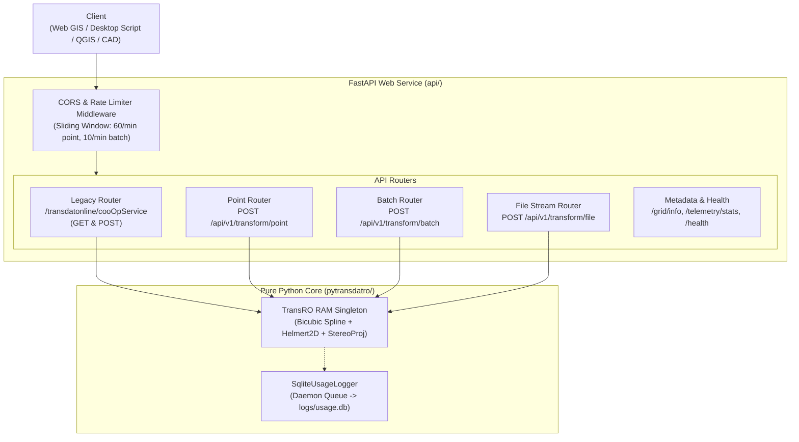

# PyTransDatRO REST API & Web Service Documentation

## 1. Overview & Architecture

The `api/` package provides a high-performance, asynchronous REST API service built on top of the pure Python `pytransdatro` geodetic library. It delivers:

1. **Modern Dual-Unit API (`/api/v1/...`)**: Fast, schema-validated JSON and streaming endpoints supporting both standard geodetic **radians** and **decimal degrees** for modern Web GIS integration.
2. **100% Backward Compatibility (`/transdatonline/cooOpService`)**: Byte-for-byte emulation of the 10+ year-old TransDatOnline/RomGeo Java servlet contract.
3. **High-Throughput File Streaming**: Line-by-line chunked streaming for delimited files (`.csv`, `.txt`) up to **100,000 points** per request.
4. **Sub-Millisecond In-Memory Execution**: The `.spg` grid is loaded into RAM once during server startup (singleton pattern). Transformations run in $< 0.05\text{ ms}$ per point without disk I/O.
5. **Non-Blocking SQLite Telemetry**: Integrates with `SqliteUsageLogger` under `source=2` (`rest_api`), recording daily volume metrics and non-sensitive ~1 km spatial density cells.
6. **Zero-Dependency Rate Limiter**: In-memory sliding-window limiter enforcing 60 req/min for point endpoints and 10 req/min for batch/file uploads per client IP.



---

## 2. Getting Started

### Installation
The core library has no web dependencies. To install the optional web service dependencies:

```bash
pip install -r requirements-api.txt
```
*(Dependencies: `fastapi`, `uvicorn`, `pydantic`, `python-multipart`, `httpx`).*

### Running the Service

#### Development Mode (with auto-reload):
```powershell
D:\anaconda3\envs\pytransdat\python.exe -m uvicorn api.main:app --host 0.0.0.0 --port 8000 --reload
```

#### Production Mode (multi-worker):
```bash
gunicorn api.main:app -w 4 -k uvicorn.workers.UvicornWorker --bind 0.0.0.0:8000
```
*Memory footprint:* $\approx 8\text{ MB}$ RAM per worker ($\approx 32\text{ MB}$ total for 4 workers).

### Interactive Documentation
Once started, visit:
- **Swagger UI**: [http://localhost:8000/docs](http://localhost:8000/docs)
- **ReDoc**: [http://localhost:8000/redoc](http://localhost:8000/redoc)

---

## 3. Endpoints Reference

### 3.1. Modern Transformation Endpoints (`/api/v1`)

#### `POST /api/v1/transform/point`
Transforms a single 2D or 3D coordinate.

* **Request Body** (`application/json`):
  ```json
  {
    "op": "Stereo70ToETRS89",
    "coos": [500000.0, 500000.0, 100.0],
    "unit": "degrees"
  }
  ```
  - `op`: `"Stereo70ToETRS89"` or `"ETRS89ToStereo70"`.
  - `coos`: `[N, E[, H]]` in meters for Stereo70, or `[Lat, Lon[, h]]` for ETRS89.
  - `unit`: `"radians"` (default) or `"degrees"` (`AngleUnitEnum`).
* **Response** (HTTP 200):
  ```json
  {
    "coos": [45.9997186280, 24.9984476351, 139.6084403992],
    "warning": null
  }
  ```
* **Domain Warning Responses** (HTTP 200 — coordinates echoed back or cleared on invalid data):
  - **Out of Grid** (`OutOfGrid2DErr` or `OutOfGrid1DErr`): `{"coos": [5.0, 1.0, 1.0], "warning": "Out of grid"}`
  - **No Data on Grid** (`NoDataGridErr`): `{"coos": [549364.0, 147553.0], "warning": "No data on grid"}`
  - **Wrong Dimension** ($< 2$ or $> 3$ values): `{"coos": [500000.0], "warning": "Wrong dimension"}`
  - **Invalid Coordinate Data** (`null`, booleans, non-numeric strings, `NaN`, `Infinity`): `{"coos": [], "warning": "Invalid coordinate data"}`

---

#### `POST /api/v1/transform/batch`
Transforms an in-memory array of coordinates (up to `settings.max_batch_points`, default 20,000 points) with full per-point fault isolation (Option B: `points: List[Any]`) via [`TransRO.transform_batch()`](../pytransdatro/trans_ro.py) and [`execute_batch_transformation()`](../api/services/transformer.py). Single-call telemetry aggregation ensures valid 2D and 3D points in a batch are recorded as one batch call rather than $N$ separate calls.

* **Request Body** (`application/json`):
  ```json
  {
    "op": "Stereo70ToETRS89",
    "points": [
      [500000.0, 500000.0, 100.0],
      [5.0, 1.0, 1.0],
      [500000.0, null]
    ],
    "unit": "degrees"
  }
  ```
* **Response** (HTTP 200):
  ```json
  {
    "results": [
      {"coos": [45.9997186280, 24.9984476351, 139.6084403992], "warning": null},
      {"coos": [5.0, 1.0, 1.0], "warning": "Out of grid"},
      {"coos": [], "warning": "Invalid coordinate data"}
    ],
    "count": 3
  }
  ```

---

#### `POST /api/v1/transform/file`
Streams transformations of an uploaded `.csv` or `.txt` file (up to `settings.max_file_points`, default 100,000 coordinate rows) using chunked HTTP transfer encoding.

* **Content-Type**: `multipart/form-data`
* **Form Fields**:
  - `file`: Uploaded file (max `settings.max_file_upload_bytes`, default 50 MB; returns HTTP `413 Payload Too Large` if exceeded).
  - `op`: `"Stereo70ToETRS89"` or `"ETRS89ToStereo70"`.
  - `unit`: `"radians"`, `"degrees"`, or `"dms"` (`FileAngleUnitEnum`, default: `"radians"`).
  - `delimiter`: `"auto"`, `"comma"`, `"semicolon"`, `"tab"`, `"space"` (default: `"auto"`; returns HTTP `422` if unrecognized).
  - `skip_header`: `true` or `false` (boolean form field, default: `false`). When `true`, passes the first non-comment data line verbatim to the output stream without transforming it or appending error/warning comments. Delimiter auto-detection is performed on the header row if `delimiter="auto"`.
* **Behavior**:
  - Automatically detects delimiter from first non-comment row when `auto` is set.
  - Strips empty lines and preserves `#` comment rows.
  - Strictly enforces 2–3 coordinate columns (or 3–4 columns when prefixed by a Point ID); rows with $< 2$ or $> 4$ columns are emitted with ` # Wrong dimension` appended, and rows with empty intermediate coordinate columns (e.g. `P1,500000,,100`) or non-finite values (`NaN`, `Inf`, `-Inf`) are emitted with ` # Invalid coordinate data` appended.
  - Strips balanced outer CSV quotes via `_strip_balanced_quotes()` while preserving trailing `"` arcsecond symbols on unquoted DMS coordinates, and validates DMS strings against strict sexagesimal bounds ($0 \le m < 60, 0 \le s < 60$, no conflicting signs/cardinals, no fractional degrees/minutes when sub-units exist) via `pytransdatro.utils.sexa_dms_chars_to_rad`.
  - Returns streaming file attachment (`transformed_coordinates.csv`).
  - Lines outside grid are emitted with ` # Out of grid` appended; lines falling in NaN grid cells are emitted with ` # No data on grid` appended.

---

### 3.2. Legacy Compatibility Endpoints

#### `GET /transdatonline/cooOpService` (and `/cooOpService`)
Maintains 100% backward compatibility with legacy scripts and GIS plugins, including Java `HttpServletRequest.getParameter()` non-null empty string semantics (`?cooOp=Stereo70ToETRS89&coos=` returns HTTP `200 {"coos": [], "warning": "Invalid coordinate data"}`, whereas missing parameters return HTTP `400`).

* **Query Parameters**:
  - `cooOp`: `"Stereo70ToETRS89"`, `"ETRS89ToStereo70"`, `"Stereo30ToETRS89"`, `"ETRS89ToStereo30"`.
  - `coos`: Semicolon-delimited numbers in **radians/meters** (e.g. `500000;500000;100`). Replicates Java `String.split(";")` semantics (trailing semicolons allowed; leading or intermediate empty tokens rejected as `"Invalid coordinate data"`).
* **Responses** (HTTP 200):
  - **Success**: `{"coos": [0.8028465450500997, 0.43630521911977527, 139.60844039916992]}` *(warning omitted)*.
  - **Out of Grid**: `{"coos": [5.0, 1.0, 1.0], "warning": "Out of grid"}` *(coordinates echoed)*.
  - **No Data on Grid**: `{"coos": [549364.0, 147553.0], "warning": "No data on grid"}` *(coordinates echoed)*.
  - **Wrong Dimension** ($< 2$ or $> 3$ coordinates): `{"coos": [500000.0], "warning": "Wrong dimension"}` *(coordinates echoed)*.
  - **Invalid Data** (non-numeric, `NaN`, `Infinity`, or empty intermediate tokens): `{"coos": [], "warning": "Invalid coordinate data"}`.
  - **Stereo 30**: `{"coos": [...], "warning": "Stereo30 transformation is obsolete and unsupported"}`.

#### `POST /transdatonline/cooOpService` (and `/cooOpService`)
Accepts `application/x-www-form-urlencoded`, `multipart/form-data` (`cooOp`, `coosArray`), and direct `application/json` bodies, validating `cooOp` eagerly before iterating over `coosArray`, enforcing `settings.max_batch_points`, and delegating to `execute_batch_transformation()` for 4-stage fault-isolated batch execution (including string-encoded numbers such as `{"coos": ["500000", "500000", "100"]}` matching Java `CooJSON.jsonToCoo()`):
```json
{
  "cooOp": "ETRS89ToStereo70",
  "coosArray": [
    {"coos": [0.8028465450500996, 0.43630521911977493, 139.7825537763764]}
  ]
}
```
* **Response**: JSON array preserving order: `[{"coos": [500000.0, 500000.0, 100.174]}]`.

---

### 3.3. Metadata & Monitoring Endpoints

* **`GET /health`**: Returns health probe `{status: "healthy", grid_loaded: true, engine_version: "1.0.0", telemetry_active: true}` (or `status: "degraded"` when `trans` is unavailable).
* **`GET /api/v1/grid/info`**: Returns active SPG file metadata, bounding box coordinates, and CRS definitions.
* **`GET /api/v1/grid/metadata`**: Returns exhaustive SPG header metadata, Helmert 2D parameters, and subgrid band statistics.
* **`GET /api/v1/grid/comparison`**: Returns official ANCPI replication benchmark summary and residual statistics.
* **`GET /api/v1/telemetry/stats`**: Returns high-level call/point volume metrics from `logs/usage.db`.
* **`GET /api/v1/telemetry/timeline`**: Returns queryable time series with summary KPIs, daily/weekly/monthly rollups, and breakdown by client source (`web_map`, `rest_api`, `desktop_cli`). Evaluates interval overlap (`period_end >= from_date AND period_start <= to_date`) and returns snapped temporal boundaries `effective_from_date` ($=\min(\text{period\_start})$) and `effective_to_date` ($=\max(\text{period\_end})$). Supports query filters (`from_date`, `to_date`, `granularity`, `source`, `operation`, `is_3d`).
* **`GET /api/v1/telemetry/spatial-matrix`**: Returns aggregated $0.1^\circ$ (~10 km) macroscopic spatial density cells and mathematical quadrant volume distributions (NW, NE, SW, SE around $45.9^\circ\text{ N}, 24.9^\circ\text{ E}$). Calculates `SUM(count_calls)` for the `calls` metric (in place of table row counts) and returns snapped temporal boundaries `effective_from_date` and `effective_to_date`. Supports filters (`from_date`, `to_date`, `metric`=`points`|`calls`, `sources`, `operation`, `is_3d`).

---

### 3.4. User Feedback Endpoint

#### `POST /api/v1/feedback`
Submits anonymous, zero-PII user discrepancy reports, bug reports, and feature suggestions (`FeedbackSubmitRequest`).
- **Request Body** (`application/json`):
  ```json
  {
    "report_type": "discrepancy",
    "description": "Observed a 2mm difference at control mark 124 near Constanța.",
    "client_timestamp": "2026-10-17T19:00:00Z",
    "app_version": "v1.0.0",
    "active_grid": "rom_grid3d_25.09.spg",
    "honeypot": ""
  }
  ```
  - `report_type`: `"discrepancy"`, `"grid_update"`, `"bug"`, `"feature"`, or `"api_down"`.
  - `description`: Detailed report text ($10 \le \text{length} \le 5000$ characters).
  - `honeypot`: Optional bot-trap field; non-empty values return a silent `"success"` response without logging or emailing.
- **Response** (HTTP 200 `FeedbackSubmitResponse`):
  ```json
  {
    "status": "logged",
    "delivered_email": false,
    "message": "Thank you! Your feedback has been recorded."
  }
  ```
- **Persistence**: Always appends a structured JSONL record to `logs/feedback.jsonl` in the configured `log_dir`, and conditionally relays via SMTP TLS if `SMTP_HOST` and `FEEDBACK_RECIPIENT_EMAIL` are configured.

---

## 4. Error Handling & Structured Error Schema

All REST API endpoints implement the uniform `ErrorResponse` model defined in `api/schemas/error.py`. Standard error responses return:

```json
{
  "detail": "Descriptive human-readable error message",
  "code": "VALIDATION_ERROR"
}
```

- **Validation Errors (HTTP 422)**: Pydantic payload parsing or schema errors return the list of failing fields under `detail` and `code: "VALIDATION_ERROR"`.
- **Bad Request Errors (HTTP 400)**: Missing parameters or invalid operation identifiers return `detail` explaining the parameter requirement.
- **Rate Limit Exceeded (HTTP 429)**: Returns rate limit notification with a `Retry-After: <seconds>` response header.
- **Backward Compatibility Guarantee**: Legacy clients expecting string `detail` properties continue to function without modification.


### 4.4 Legacy TransdatOnline Statistics Endpoints

To visualize historical transformation volumes from the predecessor TransdatOnline service (spanning 2011 to 2026), the API exposes dedicated telemetry endpoints backed by logs/legacy_stats.db:

#### GET /api/v1/telemetry/legacy/stats
Returns total point counts, broken down by client channel (pp vs service) and geodetic operation (Stereo 70 vs Stereo 30), along with timeline boundaries.

**Response**:
`json
{
  "total_points": 27745527,
  "app_st70": 21434208,
  "app_st30": 561718,
  "service_st70": 5311487,
  "service_st30": 438114,
  "from_date": "2011-01-09",
  "to_date": "2026-10-14",
  "recorded_days": 4977
}
`

#### GET /api/v1/telemetry/legacy/timeline
Returns aggregated time-series point volumes with customizable grouping and filtering.

**Query Parameters**:
- rom_date *(optional)*: Start date filter (YYYY-MM-DD).
- 	o_date *(optional)*: End date filter (YYYY-MM-DD).
- granularity *(optional)*: Time bucket grouping (daily [default], weekly, monthly).
- source *(optional)*: Comma-separated channel filter (pp, service).
- operation *(optional)*: Comma-separated operation filter (st70, st30).

---

## 5. Coordinate Conventions & Units

| Coordinate System | Type | Order | Units |
| :--- | :--- | :--- | :--- |
| **Stereo 70** | Projected Grid (EPSG:31700) | `[Northing, Easting[, H]]` | **Meters** ($m$) |
| **ETRS89 (Default)** | Geographic (EPSG:4258 / WGS84) | `[Latitude, Longitude[, h]]` | **Radians** ($rad$) for Lat/Lon; **Meters** for $h$ |
| **ETRS89 (`unit="degrees"`)** | Geographic (EPSG:4258 / WGS84) | `[Latitude, Longitude[, h]]` | **Decimal Degrees** ($^\circ$) for Lat/Lon; **Meters** for $h$ |

---

## 6. Rate Limiting

The built-in sliding-window rate limiter prevents abuse on public deployments:
- **Point Endpoints** (`/api/v1/transform/point`, legacy GET): **60 requests / minute / IP**.
- **Batch & File Endpoints** (`/api/v1/transform/batch`, `/api/v1/transform/file`, legacy POST): **10 requests / minute / IP**.
- **Rate Limit Response**: HTTP `429 Too Many Requests` with a `Retry-After: <seconds>` header.

---

## 7. Configuration & Environment Variables

The web API is configured through `api/config.py` using Pydantic `BaseSettings`. Configuration values can be set via `.env` file or environment variables:

| Variable | Default | Description |
| :--- | :--- | :--- |
| `HOST` | `0.0.0.0` | Server binding address. |
| `PORT` | `8000` | Server HTTP port. |
| `CORS_ORIGINS` | `["*"]` | Allowed CORS origins (JSON array or comma-separated string). |
| `LOG_DIR` | `./logs` | Directory for `usage.db` SQLite telemetry and `feedback.jsonl`. |
| `LOG_LEVEL` | `INFO` | Python logging level (`DEBUG`, `INFO`, `WARNING`, `ERROR`). |
| `RATE_LIMIT_POINT` | `60` | Point transformations per minute per IP. |
| `RATE_LIMIT_BATCH` | `10` | Batch transformations / file uploads per minute per IP. |
| `RATE_LIMIT_WINDOW_SECONDS` | `60.0` | Sliding window duration in seconds. |
| `MAX_FILE_SIZE_BYTES` | `20971520` | Max file upload size (20 MB). |
| `MAX_FILE_LINES` | `100000` | Max line limit for streaming file transformations. |
| `SMTP_HOST` | `None` | SMTP mail server for user feedback notifications. |

---

## 8. Code Examples for Developers

### Python (`requests`)
```python
import requests

url = "http://localhost:8000/api/v1/transform/point"
payload = {
    "op": "Stereo70ToETRS89",
    "coos": [500000.0, 500000.0, 100.0],
    "unit": "degrees"
}
response = requests.post(url, json=payload)
data = response.json()
print("Transformed:", data["coos"])  # [45.9997186280, 24.9984476351, 139.6084]
```

### JavaScript / Browser (`fetch`)
```javascript
const response = await fetch("http://localhost:8000/api/v1/transform/point", {
  method: "POST",
  headers: { "Content-Type": "application/json" },
  body: JSON.stringify({
    op: "Stereo70ToETRS89",
    coos: [500000.0, 500000.0, 100.0],
    unit: "degrees"
  })
});
const data = await response.json();
console.log("Latitude:", data.coos[0], "Longitude:", data.coos[1]);
```

### cURL (Command Line)
```bash
# Single point in degrees
curl -X POST "http://localhost:8000/api/v1/transform/point" \
  -H "Content-Type: application/json" \
  -d '{"op": "Stereo70ToETRS89", "coos": [500000.0, 500000.0, 100.0], "unit": "degrees"}'

# Legacy GET endpoint
curl "http://localhost:8000/transdatonline/cooOpService?cooOp=Stereo70ToETRS89&coos=500000;500000;100"
```

