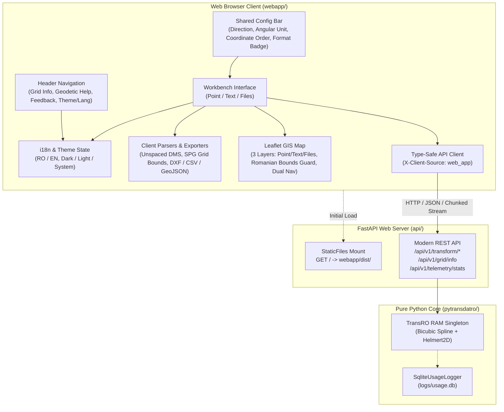

# PyTransDatRO Web Application Architecture & Specification

## 1. Overview & Architecture

The `webapp/` package provides a modern, high-performance Web GIS Single Page Application (SPA) designed to bring Romania's official geodetic coordinate transformation platform (**TransDatRO**) into modern web browsers.

It replaces the legacy Java/GWT TransDatOnline web interface with a responsive, zero-framework, client-side application built with **Vite**, **TypeScript**, **Vanilla CSS**, and **Leaflet**.



---

## 2. Technology Stack & Key Invariants

1. **Vanilla CSS Design System & Visual Ergonomics**:
   - Zero bulky CSS frameworks (no Bootstrap, no Tailwind runtime overhead).
   - Driven entirely by custom CSS design tokens defined in [`webapp/src/style/variables.css`](../webapp/src/style/variables.css) and documented in [`webapp/design_guide.md`](../webapp/design_guide.md).
   - **The Trinity Balance**: Simplicity (zero decorative emojis), Optimal ergonomics (480px workbench panel, asymmetrical 3-column coordinate layout), and Modern engineering precision.
   - **Theme-Native High-Contrast CTA**: Porcelain `#f8fafc` on dark obsidian; slate `#0f172a` on light porcelain.
   - **Metric Color Isolation**: Physical scalar measurements (e.g., Quasigeoid Height $\zeta = h - H$) use dedicated technical cyan (`--color-metric-text: #38bdf8;`), strictly isolated from status colors (never green or red).
   - **Seamless Folder Bookmark Tabs**: Physical continuity between the `.tabs-bar` and the active card container below with zero background gap.

2. **Strict TypeScript & Vite**:
   - Strict TypeScript compilation (`tsconfig.json`) ensuring robust domain typing for coordinates, operations, units, and API payloads.
   - Bundled with Vite for instant Hot Module Replacement (HMR) during development and optimized tree-shaken production bundles (~78 KB gzipped).

3. **Leaflet Web GIS Engine & 3-Layer Separation**:
   - High-performance, lightweight mapping powered by `leaflet` and `leaflet.markercluster`.
   - **3 Independent LayerGroups**: `pointLayer`, `textLayer`, and `filesLayer`, independently managed and toggleable in the layer control.
   - **Decoupled Viewports**: Coordinate transformations never auto-pan or jump the map.
   - **Dual Map Navigation Actions**: Dedicated `Center on Map` (pans to centroid at current zoom) and `Zoom to Extents` (fits bounds or zooms to level 14 for a single point) on every tab.
   - **Boundary-Safe Guard**: Map centering and bounds fitting are strictly guarded within Romania's geographic grid envelope (`[43.5, 20.2]` to `[48.3, 29.8]`), preventing map jumps on invalid coordinates.
   - Pre-configured basemaps: OpenStreetMap, CartoDB Positron, CartoDB Dark Matter, and ESRI World Imagery.

4. **Decoupled API Contract**:
   - The frontend communicates with the backend exclusively via standard REST endpoints (`/api/v1/...`).
   - Every outbound request injects the HTTP header `X-Client-Source: web_app`, allowing backend telemetry to accurately differentiate browser traffic from automated scripts or desktop CAD plugins.

---

## 3. Core Functional Modules

### A. 3-Tier Shared Transformation Configuration Bar (`main.ts`)
Elevated above all tabs, governing `Point`, `Text`, and `Files` globally:
- **Tier 1 (Direction Toggle)**: Sliding directional toggle with a sleek 6px rounded-rectangle glider (`var(--radius-sm)`). Default: `ETRS89 ➔ Stereo 70` (first button); `Stereo 70 ➔ ETRS89` (second button).
- **Tier 2 (50/50 Balanced Split)**: `Angular unit: [select]` (Degrees, DMS, Radians) | `Coordinate order: [ NE(H) | EN(H) ]`. Sentence-case labeling.
- **Tier 3 (Dynamic Format Example)**: Selectable badge displaying copy-ready formatted coordinates (`45.84123450`, `45°50'28.44420"`, `0.7997813210`). Clicking the badge copies strictly the numeric angle value without label text.

### B. Single Point Transformation (`PointConverter.ts`)
- **Projection Center Defaults**: Initial input coordinates set to Romania's projection center origin:
  - Latitude $\phi = 46.0^\circ\text{ N}$ (`46°00'00.00000"` in DMS)
  - Longitude $\lambda = 25.0^\circ\text{ E}$ (`25°00'00.00000"` in DMS)
  - Ellipsoidal Height $h = 100.0\text{ m}$
- **Asymmetrical 3-Column Layout**: Northing/Lat (`1.35fr`), Easting/Lon (`1.35fr`), and Altitude/Height (`0.8fr`) so long DMS strings never wrap or clip.
- **Auto 2D/3D Dimensionality Detection**: Empty 3rd coordinate $\to$ 2D mode; provided 3rd coordinate $\to$ 3D mode (calculates $\zeta = h - H$).
- **Output Hygiene**: Pure numeric values only (strips `m`, `°`, `rad` from text boxes). Displays persistent `—` when cleared or invalid, preventing vertical layout shift.
- **Top-Right Code-Block Copy Action**: Header copy icon with instant `✓ Copied` feedback.
- **Focus Auto-Select**: All coordinate inputs execute `input.select()` on focus.
- **Dedicated Quasigeoid Height Field**: Rendered in its own dedicated box on its own row using technical metric cyan-blue (`--color-metric-text`).
- **Unspaced DMS Formatting & Paste Guard**: `DD°MM'SS.SSSSS"` formatting with single-DMS paste splitting protection.
- **Client-Side SPG Pre-Flight Check**: Instant validation against Romania's grid envelope ([`gridBounds.ts`](../webapp/src/utils/gridBounds.ts)) before dispatching network calls.
- **Unified Quality Report**: Positioned directly below outputs, displaying `In Grid`, `Outside Grid`, and calculation mode.

### C. Batch Text Transformation (`BatchConverter.ts`)
- **Strict Vertical Layout**: Input textarea $\to$ Primary Transform button $\to$ Output textarea $\to$ Quality Report $\to$ Download actions $\to$ Map actions.
- **Strict Numeric Validation**: Regex check (`isValidDecimal`) prevents non-numeric typos (e.g. `5001a50.000`) from being partially evaluated into false coordinates.
- **Strict 1-to-1 Line Correspondence**: Input row $N$ maps directly to output row $N$. Empty lines, comments, and invalid rows maintain their exact sequence index.
- **Human 1-Based Indexing**: Unnamed coordinates are referenced as `Point 1`, `Point 2`, etc.
- **Out-of-Grid Suppression**: Suppresses bogus approximate transformed coordinates, emitting only `[Point_ID], # Out of grid`.
- **Top-Right Copy Action**: Output header includes a dedicated `Copy Results` button.
- **Relocated Download Group**: Export actions (`CSV`, `GeoJSON`, `DXF`) grouped below output under `Download As:`.

### D. Bulk File Streaming Pipeline (`FileUpload.ts`)
- **Interactive Queue**: Multi-file dropzone with file list, file size indicators, individual `✕` remove buttons, and manual `Transform Files` trigger.
- **Raw Preview Elimination**: Replaced 5-line text preview with clean queue metadata and post-transformation Quality Report cards.
- **Line Streaming Robustness**: Auto-detects Point ID column (3 vs 4 tokens), parses DMS angles with sexagesimal radian conversion, outputs unspaced DMS, and handles Windows-1252 / Latin-1 degree symbol fallback decoding.
- **Downloads**: Individual transformed file downloads plus batch `Download All (ZIP)`.

### E. Interactive Web GIS Map (`MapView.ts`)
- **Desktop Split-Screen**: Left-hand 480px workbench panel paired with a full-height interactive Leaflet map.
- **3-Layer Visibility Management**: `pointLayer`, `textLayer`, and `filesLayer` allow users to toggle visibility independently.
- **Decoupled Viewports & Dual Navigation**:
  - `Center on Map`: Pans to centroid of valid in-grid coordinates while preserving user zoom level.
  - `Zoom to Extents`: Pans and fits bounds to encompass all points (or zooms to level 14 for a single point).
- **Smart Map Click**:
  - In `ETRS89ToStereo70`: Populates clicked lat/lon formatted in active angular units.
  - In `Stereo 70ToETRS89`: Calls backend API to reverse-calculate clicked point into Stereo 70 projection meters.
- **High-Volume Guardrail Modal (`VolumeWarningModal.ts`)**:
  - If a batch exceeds **2,000 points**, a warning modal prompts the user before plotting:
    1. *Render All Points* (with Marker Clustering).
    2. *Sample Preview* (render first 1,000 points only).
    3. *Skip Map* (display table/export results only to preserve responsiveness).

### F. Client-Side Multi-Format Exporters (`exporters.ts`)
- **CSV**: Configurable delimiter (Comma, Semicolon, Tab) with clean header metadata, respecting active coordinate order (`NE` vs `EN`) and suppressing coordinates for out-of-grid points.
- **GeoJSON**: Standard WGS84/ETRS89 `Point` FeatureCollections with coordinate properties.
- **AutoCAD DXF**: R12 ASCII DXF generating native `POINT` entities for immediate drag-and-drop import into AutoCAD and Civil 3D.

### G. Header Navigation & Documentation Modals (`Header.ts`)
- **Grid Info (`StatsView.ts`)**: Operational telemetry, daily point volume charts, and active `.spg` grid metadata.
- **Geodetic Help (`GeodeticHelpModal.ts`)**: Interactive reference guide documenting Romanian datums (Stereo 70, ETRS89, MN75, GRS80), Quasigeoid undulation ($\zeta = h - H$), and syntax conventions.
- **Feedback Dialog (`FeedbackModal.ts`)**: Discrepancy reporting against desktop TransDat or national GNSS stations.

---

## 4. Internationalization (`i18n`) & Aesthetics

The application is fully bilingual:
- **Romanian (`ro`)**: Default system language, matching official Romanian geodetic terminology (e.g. *Cota elipsoidală*, *Stereografic 1970*, *Înălțimea cvasigeoidului*).
- **English (`en`)**: Complete localization for international users and cross-border projects.

### Reactive State Flow:
```
User clicks RO/EN Switcher
   │
   ▼
i18nStore.setLanguage('en')
   │
   ├── Persists to localStorage['pytransdat_lang']
   └── Triggers all registered subscriber callbacks (re-renders labels in-place)
```

---

## 5. Deployment & Production Serving

In production, the compiled frontend bundle is hosted directly by the FastAPI web service:

```
FastAPI Server (api/main.py)
   ├── /api/v1/*                --> JSON & Streaming Endpoints
   ├── /transdatonline/*        --> Legacy Compatibility Endpoints
   ├── /health, /docs, /redoc   --> Observability & OpenAPI
   └── /                        --> StaticFiles(directory="webapp/dist", html=True)
```

### Build Instructions:

```bash
# 1. Compile frontend assets
cd webapp
npm install
npm run build

# 2. Start the unified web service
cd ..
D:\anaconda3\envs\pytransdat\python.exe -m uvicorn api.main:app --host 0.0.0.0 --port 8000
```

The web app is then immediately served at `http://127.0.0.1:8000/`.

---

## 6. Verification & Quality Assurance

- **Frontend Build Verification**:
  ```bash
  npm --prefix webapp run build
  ```
  Ensures 0 TypeScript type errors and successful Vite bundling into `webapp/dist/`.
- **Backend Test Suite**:
  ```bash
  D:\anaconda3\envs\pytransdat\python.exe -m pytest tests/
  ```
  Ensures all 73 core, API, streaming, and telemetry tests pass without regressions.
