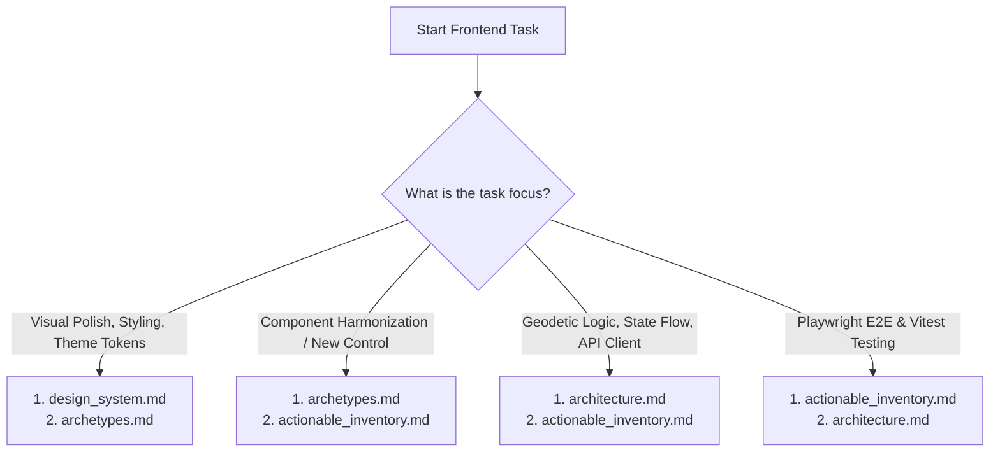

# PyTransDatRO Web Application Documentation Hub (`docs/webapp/`)

This directory is the single source of truth for the **PyTransDatRO** web application (`webapp/`). It organizes all frontend documentation into specialized, purpose-built layers to ensure that human developers and AI coding agents can quickly locate exact specifications without context clutter.

---

## 1. Documentation Sitemap

| Document | Primary Audience | Purpose & Contents |
| :--- | :--- | :--- |
| **[`README.md`](./README.md)** | **All Developers & Agents** | Navigation hub, task-based reading guide, canonical naming standard, and cross-cutting golden invariants. |
| **[`design_system.md`](./design_system.md)** | **UI Designers & Frontend Developers** | Visual design manual, GitHub Primer neutral dual-theme palette, Subtle Surface + Border (`#8`) primary CTA, typography, 480px panel & 3-column coordinate grid layout invariants, and C2 Graticule brand logo. |
| **[`archetypes.md`](./archetypes.md)** | **Component Architects & UI Refiners** | Component catalog grouping all multi-instance controls (tabs, sliders, multi-check toggles, labels, inputs, CTAs, copy buttons, KPI cards) with styling consistency rules and DOM selectors. |
| **[`architecture.md`](./architecture.md)** | **Frontend & Backend Engineers** | Living software engineering architecture: SPA component hierarchy, reactive state flow, localStorage persistence, REST API contracts, coordinate parsers, file queue state machine, and Web GIS Leaflet integration. |
| **[`actionable_inventory.md`](./actionable_inventory.md)** | **QA Engineers & Test Automation Agents** | Exhaustive interaction inventory documenting every actionable UI control, DOM locator, user action, target scope, expected side-effects, and automated Playwright / Vitest test mappings. |

---

## 2. Task-Based Reading Guide (Agent & Developer Directives)

To optimize cognitive context and avoid token overhead during development, consult strictly the documents required for your specific task domain:

- **Styling, Visual Polish & Token Refinements**:
  - Read: [`design_system.md`](./design_system.md) and [`archetypes.md`](./archetypes.md).
  - *Ignore*: [`architecture.md`](./architecture.md).
- **Adding or Standardizing Interactive Controls**:
  - Read: [`archetypes.md`](./archetypes.md) (to match an existing archetype) and [`actionable_inventory.md`](./actionable_inventory.md) (to register the new actionable element).
- **Geodetic Parsing, API Integration & State Flow**:
  - Read: [`architecture.md`](./architecture.md).
  - *Ignore*: [`design_system.md`](./design_system.md).
- **Automated Testing & Bug Reproduction**:
  - Read: [`actionable_inventory.md`](./actionable_inventory.md) and [`architecture.md`](./architecture.md).

---

## 3. Canonical Naming Standard (No Fragile Numeric IDs)

Across all documentation, agent skills, and test specifications, UI elements are identified strictly by their **Human Canonical Name** paired with their primary **DOM Locator / Test Selector**:

$$\text{Format: } \textbf{Human Canonical Name} \text{ (}\texttt{\#dom-selector}\text{)}$$

### Examples:
- `Coordinate 1 Input (#pt-input-1)`
- `Direction Sliding Toggle (.sliding-toggle)`
- `Batch Transform CTA Button (#batch-transform-btn)`
- `API Health Indicator Dot (#header-health-dot-btn)`
- `Center on Map Button (#pt-center-map-btn)`

> [!IMPORTANT]
> **No Synthetic Numeric IDs**:
> Do not invent synthetic numerical identifiers (such as `ID_104` or `CONTROL_22`). Numbered identifiers drift out of sync across files when controls are added or reordered. The canonical name paired with the DOM selector provides an unambiguous, permanently verifiable identity.

---

## 4. Cross-Cutting Golden Invariants

All web application development, visual updates, and test suites must uphold these universal architectural rules:

1. **The Golden Rule of Quality Reporting (Zero Inline Banners)**:
   - All inline error banners beneath coordinate inputs are strictly prohibited.
   - Validation feedback is communicated exclusively through the structured **Two-Section Quality Report Card** (`Coordinates` top subsection, dashed divider line, `Transformation` bottom subsection).
2. **Strict Number & Decimal Separator Isolation**:
   - **Usage / Telemetry Dashboard**: Numbers and cards follow active locale formatting (Romanian uses comma `,` decimal separator; English uses period `.`).
   - **Coordinate Transformation Engine**: All coordinate inputs, coordinate outputs, angle format badges, clipboard copies, and exported files (CSV, GeoJSON, DXF) **strictly remain in standard dot `.` decimal format** to guarantee interoperability with CAD, GIS, and scientific engineering software.
3. **Map Marker Symbology & Color Preservation**:
   - Point markers on the map strictly retain their assigned layer color from the Layers drawer (never turn red, flash, or change color on error or out-of-grid status).
   - Single-point markers feature a continuous soft pulsing ripple animation (`markerPulse`) at all times.
   - Coordinate validity is communicated exclusively through the workbench reporting area.
4. **Single Distance Measurement Ergonomics**:
   - The map distance ruler measures strictly one single distance at a time. Starting a 3rd click clears the previous measurement line and tooltip. Pressing `Escape` cancels measurement mode.
5. **Clean Vector Export Filtering**:
   - **CSV Export**: Exact line-by-line replica of computed results (preserving comments, empty rows, and error comments).
   - **GeoJSON & AutoCAD DXF Exports**: Strictly filter out invalid rows (out-of-grid, no data on grid, syntax errors, invalid angles) to prevent geometry corruption in GIS/CAD software.
6. **Subtle Surface + Border Primary Action Button**:
   - The primary `Transform` CTA button spans the full width of the `480px` panel using an elevated neutral surface fill with a crisp structural border (`--btn-primary-bg`, `--btn-primary-border`, `--btn-primary-text`), avoiding harsh saturated blue or green blocks.
7. **Zero Decorative Emojis**:
   - Tab labels, primary action buttons, dialog choices, and segmented options never contain informal emojis (no ⚡, ⬍, ⬄, 🧭). Clean typography communicates technical authority.
