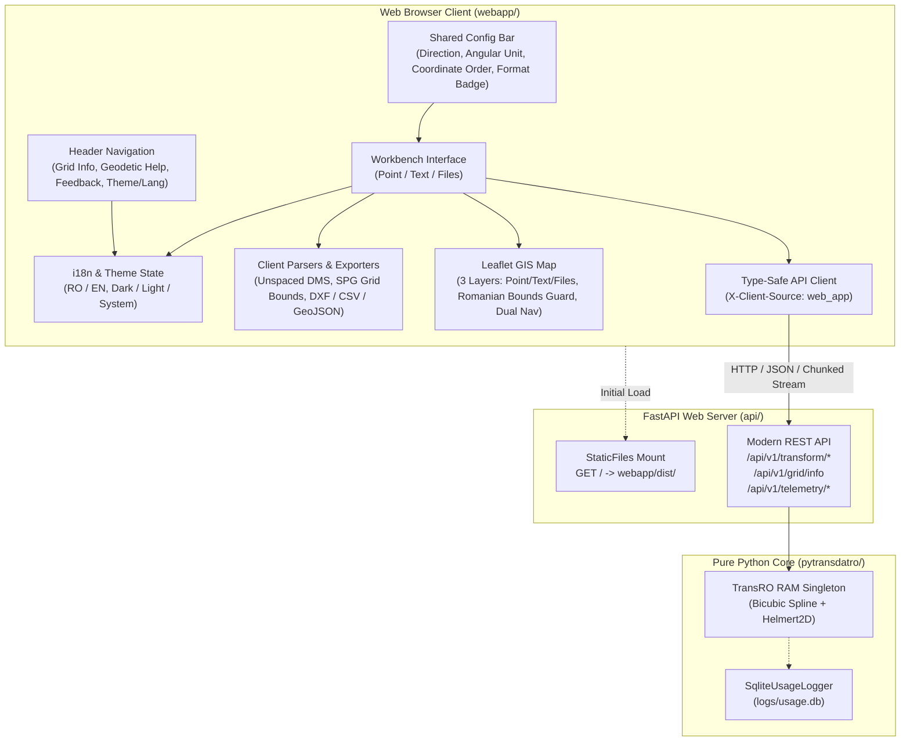

# PyTransDatRO Web Application — Software Architecture & Specification

## 1. Overview & Architecture

The `webapp/` package provides a modern, high-performance Web GIS Single Page Application (SPA) designed to bring Romania's official geodetic coordinate transformation platform (**TransDatRO**) into modern web browsers.

It replaces the legacy Java/GWT TransDatOnline web interface with a responsive, zero-framework, client-side application built with **Vite**, **TypeScript**, **Vanilla CSS**, and **Leaflet**.



> [!NOTE]
> Visual design tokens and UI philosophy live in [`design_system.md`](./design_system.md). Component groupings live in [`archetypes.md`](./archetypes.md). The exhaustive interaction inventory and test mapping live in [`actionable_inventory.md`](./actionable_inventory.md).

---

## 2. Technology Stack & Key Invariants

1. **Vanilla CSS Design System & Modular Stylesheets**:
   - Zero bulky CSS frameworks (no Bootstrap, no Tailwind runtime overhead).
   - Driven entirely by custom CSS design tokens defined in `webapp/src/style/variables.css` and documented in [`design_system.md`](./design_system.md).
   - **GitHub Primer Dual-Theme Palette & Subtle Surface + Border (`#8`) Primary Button (`data-theme="dark | light"`)**:
     - Dark mode uses neutral carbon-slate `#0d1117` (`--bg-app`) and `#161b22` (`--bg-surface`); Light mode uses `#f6f8fa` (`--bg-app`) and `#ffffff` (`--bg-surface`).
     - The full-width `Transform` primary button uses the **Subtle Surface + Border (`#8`)** token set (`--btn-primary-bg: #1f2630`, `--btn-primary-border: #48586a`, `--btn-primary-text: #e6edf3` in dark mode; `--btn-primary-bg: #eaeef2`, `--btn-primary-border: #8c959f`, `--btn-primary-text: #1f2328` in light mode).
   - **Modular Stylesheet Architecture (`webapp/src/style/`)**:
     - `variables.css`: GitHub Primer Dark/Light tokens, Subtle Surface + Border (`#8`) primary button tokens, technical metric tokens, and dual-theme logo tokens (`--logo-*`).
     - `base.css`: CSS reset, body defaults, custom scrollbars, and selection styling.
     - `layout.css`: 480px workbench panel, top navigation bar, 2-line lowercase `"powered by"` / `"PyTransDatRO"` left-zone attribution, folder bookmark tabs, studio cards, modals, and toasts.
     - `forms.css`: Text inputs, selects, high-contrast ON/OFF sliding direction toggle, segmented switches, and dropzone.
     - `buttons.css`: Primary CTA (`.btn-primary`), secondary, outline, copy buttons, and action buttons.
     - `badges.css`: Status pills, Quasigeoid height metric field, angle format badges, and quality report cards.
     - `menus.css`: Top navigation menu item triggers (`.nav-menu-trigger`), dropdown panels, active checkmarks (`.menu-check-icon`), menu items, and dividers.
     - `panels.css`: Draggable and resizable non-modal floating windows (`.floating-grid-panel`, `.floating-help-panel`, `.floating-feedback-panel`).
     - `telemetry.css`: KPI cards, high-contrast ON/OFF filter toggles with `6px × 6px` status dot indicators, SVG timeline chart styling with interactive `.legend-color-popover` swatch pickers, and spatial matrix canvas deck.
     - `map.css`: Theme-synchronized Leaflet map widgets, docks, drawers, scale bar, and popups.
   - **Dual-Theme Brand Logo (`Map Projection Graticule`, `webapp/src/assets/logos.ts`)**:
     - The official **Map Projection Graticule** vector mark is rendered inline via CSS variables (`getLogoInlineSvg(36)`) in the header and synchronized dynamically with the browser favicon (`syncFaviconWithTheme`).
   - **The Trinity Balance**: Simplicity (zero decorative emojis), Optimal ergonomics (480px workbench panel, asymmetrical 3-column coordinate layout), and Modern GIS/Cartographic engineering precision.
   - **Metric Color Isolation**: Physical scalar measurements (e.g., Quasigeoid Height $\zeta = h - H$) use the dedicated cyan/teal metric token (`--color-metric-text`), strictly isolated from status colors (never green, red, or yellow).
   - **Seamless Folder Bookmark Tabs**: Physical continuity between the `.tabs-bar` and the active card container below with zero background gap.

2. **Reusable TypeScript UI Factory System (`webapp/src/ui/`)**:
   - `renderDropdownMenu(props)`: Generates accessible dropdown menus with `.nav-menu-trigger` menu-item aesthetics, rotating chevron animations, optional `active` radio checkmarks (`role="menuitemradio"`, `.menu-check-icon`), custom `menuWidth`, ARIA semantics, and keyboard navigation (`Escape`, `ArrowDown`, `ArrowUp`).
   - `renderSegmentedControl(props)`: Accessible radio-switch controls with keyboard arrow navigation.
   - `renderSelect(props)`: Type-safe dropdown selects with focus ring management.
   - `renderCopyBadge(props)`: Interactive copyable text badges with clipboard integration.
   - `renderCopyButton(props)`: Standard code-block copy buttons with animated checkmark feedback.

3. **Strict TypeScript & Vite**:
   - Strict TypeScript compilation (`tsconfig.json`) ensuring robust domain typing for coordinates, operations, units, and API payloads.
   - Bundled with Vite for instant Hot Module Replacement (HMR) during development and optimized tree-shaken production bundles (~105 KB gzipped).

4. **Leaflet Web GIS Engine & 3-Layer Architecture**:
   - High-performance, lightweight mapping powered by `leaflet` and `leaflet.markercluster`.
   - **3 Independent LayerGroups**: `pointLayer`, `textLayer`, and `filesLayer`, independently managed with live point counters and 6-color customizable swatch pickers (Cyan, Cobalt, Emerald, Amber, Violet, Rose) with `localStorage` persistence.
   - **Full Marker & Cluster Color Synchronization**: Dynamic cluster icons (`custom-cluster-circle`) inherit the exact active swatch color, synchronizing markers, zoom-out cluster bubbles, Layers drawer swatches, and Legend dots.
   - **Decoupled Viewports & Dual Navigation**: Coordinate transformations never auto-pan or jump the map; dedicated `Center on Map` and `Zoom to Extents` actions are provided across Point, Text, and Files tabs.
   - **Boundary-Safe Guard**: Map centering and bounds fitting are strictly guarded within Romania's geographic grid envelope (`[43.5, 20.2]` to `[48.3, 29.8]`), preventing map jumps on invalid coordinates.
   - **Custom Ergonomic Docks**:
     - *Top-Left Controls Dock*: Grouped buttons for Zoom In/Out, **Zoom to Romania (Home)**, **Metric Distance Measurement Ruler**, and **Fullscreen Toggle** (with `fullscreenchange` synchronization).
     - *Top-Right Expandable Legend & Scale Bar*: Stateful persistent Legend widget (persisted in `localStorage['pytransdat_legend_open']`) that automatically reflows above a high-contrast segmented **GIS Graphic Scale Bar** (with start `0` and end `[max] m/km` labels).
     - *Bottom-Left Layers Drawer*: 32x32px icon-only button opening a structured drawer organized into Data Layers, Shift Grids (Coming Soon), and Base Maps (OpenStreetMap default, with user choice persisted in `localStorage['pytransdat_basemap']`).
     - *Bottom-Center Coordinates Badge*: Abbreviated `Lat: [val]  Long: [val]` responsive to active angular units (Degrees, DMS, Radians), elevated on mobile screens.
   - **Uniform Geodetic Popups**: Unified attribute tables across all layers distinguishing Stereo 70 Normal Altitude ($H$, Black Sea 1975) from ETRS89 Ellipsoidal Height ($h$, GRS80), Quasigeoid height $\zeta$ in cyan, and 1-click **Copy Attributes** (`Copiază atributele`) key-value clipboard action with in-place feedback.

5. **Decoupled API Contract**:
   - The frontend communicates with the backend exclusively via standard REST endpoints (`/api/v1/...`).
   - Every outbound request injects the HTTP header `X-Client-Source: web_app`, allowing backend telemetry to accurately differentiate browser traffic from automated scripts or desktop CAD plugins.

---

## 3. Core Functional Modules

### A. 3-Tier Shared Transformation Configuration Bar (`main.ts`)
Elevated above all tabs, governing `Point`, `Text`, and `Files` globally:
- **Tier 1 (Direction Toggle)**: Sliding directional toggle with a sleek 6px rounded-rectangle glider (`var(--radius-sm)`). Default: `ETRS89 ➔ Stereo 70` (first button); `Stereo 70 ➔ ETRS89` (second button).
- **Tier 2 (50/50 Balanced Split)**: `Angular unit: [select]` (Degrees, DMS, Radians) | `Coordinate order: [ NE(H) | EN(H) ]`. Sentence-case labeling.
- **Tier 3 (Dynamic Format Example)**: Selectable badge displaying copy-ready formatted coordinates (`45.84123450`, `45°50'28.44420"`, `0.7997813210`). Clicking the badge copies strictly the numeric angle value without label text.

### B. Single Point Transformation (`PointConverter.ts`)
- **Projection Center Defaults**: Initial input coordinates set to Romania's projection center origin:
  - Latitude $\phi = 46.0^\circ\text{ N}$ (`46°00'00.00000"` in DMS)
  - Longitude $\lambda = 25.0^\circ\text{ E}$ (`25°00'00.00000"` in DMS)
  - Ellipsoidal Height $h = 100.0\text{ m}$
- **Asymmetrical 3-Column Layout**: Northing/Lat (`1.35fr`), Easting/Lon (`1.35fr`), and Altitude/Height (`0.8fr`) so long DMS strings never wrap or clip.
- **Auto 2D/3D Dimensionality Detection**: Empty 3rd coordinate $\to$ 2D mode; provided 3rd coordinate $\to$ 3D mode (calculates $\zeta = h - H$).
- **Output Hygiene**: Pure numeric values only (strips `m`, `°`, `rad` from text boxes). Displays empty text fields (`""`) when cleared or untransformable, eliminating stale or misleading numbers.
- **Top-Right Code-Block Copy Action**: Header copy icon with instant `✓ Copied` feedback.
- **Focus Auto-Select**: All coordinate inputs execute `input.select()` on focus.
- **Dedicated Quasigeoid Height Field**: Rendered in its own dedicated box on its own row using technical metric cyan-blue (`--color-metric-text`).
- **Unspaced DMS Formatting & Paste Guard**: `DD°MM'SS.SSSSS"` formatting with single-DMS paste splitting protection. Sexagesimal symbols (`°`, `'`, `"`) are explicitly retained on angle displays as a geodetic exception to unit omission.
- **Smart Delimiter Split & Smart Paste**: Pasting a full 2D or 3D coordinate line (space, comma, semicolon, tab) splits across inputs and automatically triggers calculation. Manual entry requires `Enter` or clicking `Transform`.
- **Client-Side SPG Pre-Flight Check**: Instant validation against Romania's grid envelope before dispatching network calls.
- **The Golden Rule & Two-Section Quality Report**:
  - Completely eliminates ad-hoc inline `.error-banner` alerts below coordinate boxes. All transformation diagnostics are unified through the standardized quality reporting card.
  - Divided into two discrete sections: `Coordinates` (Top: `2D` or `3D`) and `Transformation` (Bottom: `✓ Valid`, `⚠ Outside Grid`, `⚠ No Grid Data`, `✕ Invalid Angle`, `✕ Invalid Input`) separated by a discrete dashed divider line (`.quality-report-divider-dashed`) and subtle section headers (`.quality-section-header`).
  - Impossible angular values ($|\text{Lat}| > 90^\circ$ or $|\text{Lon}| > 180^\circ$, e.g. `500000.000`) are flagged at parse time as dedicated `Invalid Angle` rather than misdiagnosed as "Out of grid".

### C. Batch Text Transformation (`BatchConverter.ts`)
- **Strict Vertical Layout**: Input textarea $\to$ Primary Transform button $\to$ Output textarea $\to$ Two-Section Quality Report $\to$ Download actions $\to$ Map actions.
- **Strict Numeric Validation**: Regex check (`isValidDecimal`) prevents non-numeric typos (e.g. `5001a50.000`) from being partially evaluated into false coordinates.
- **Strict 1-to-1 Line Correspondence**: Input row $N$ maps directly to output row $N$. Empty lines, comments, and invalid rows maintain their exact sequence index.
- **Human 1-Based Indexing**: Unnamed coordinates are referenced as `Point 1`, `Point 2`, etc.
- **Clean Error Output Rows**: Non-computable input rows output only Point Name (if present) and quality comment (e.g. `104, # Invalid input` or `101, # Invalid angle` or `# Invalid input`), completely omitting invalid coordinate numbers.
- **Textarea Height Persistence**: User-adjusted vertical heights on input and output textareas are cached (`savedInputHeight`, `savedOutputHeight`) and restored across `Transform` calculations.
- **Custom Scrollbar Hover Detection**: Dynamically switches the mouse cursor to the `default` arrow when hovering over the textarea scrollbar gutter rather than inheriting the text I-beam.
- **Standardized Two-Section Quality Report**: Positioned directly beneath outputs, displaying `Coordinates` (`Total: [N]`, `2D: [N]`, `3D: [N]`) and `Transformation` (`Valid ([N])`, `Outside Grid ([N])`, `No Grid Data ([N])`, `Invalid Angle ([N])`, `Invalid Input ([N])`).
- **Silent Native Downloads**: Eliminated premature synthetic "File Downloaded" toasts on CSV, GeoJSON, and DXF button clicks, delegating feedback to native browser save dialogs.
- **Top-Right Copy Action**: Output header includes a dedicated `Copy Results` button with instant clipboard feedback.
- **Relocated Download Group**: Export actions (`CSV`, `GeoJSON`, `DXF`) grouped below output under `Download As:`.

### D. Bulk File Streaming Pipeline (`FileUpload.ts`)
- **Interactive Queue**: Multi-file dropzone with file list, file size indicators, individual `✕` remove buttons, and manual `Transform Files` trigger.
- **Staged Workflow**: Supports staging multiple files, transforming them, changing global transformation settings (e.g. coordinate order or direction), staging additional files, and transforming the untransformed files using the updated app settings.
- **Cumulative Map Visualization**: Map displays markers and clusters cumulatively from all processed files in the queue.
- **Two-Section Quality Report**: Cumulative post-transformation summary divided into `Coordinates` (`Total: [N]`, `2D: [N]`, `3D: [N]`) and `Transformation` (`Valid ([N])`, `Outside Grid ([N])`, `Invalid Input ([N])`) with batch `Download All` trigger.
- **Line Streaming Robustness**: Auto-detects Point ID column (3 vs 4 tokens), parses DMS angles with sexagesimal radian conversion, outputs unspaced DMS, and handles Windows-1252 / Latin-1 degree symbol fallback decoding.
- **Downloads**: Individual transformed file downloads plus batch `Download All`.

### E. Interactive Web GIS Map & Responsive Viewport Topology (`MapView.ts`)
- **Desktop Split-Screen & Dockable Workbench**: Left-hand 480px workbench panel paired with a full-height interactive Leaflet map. Includes a sleek vertical divider collapse toggle (`#workbench-dock-toggle`) allowing users to slide the workbench shut (`margin-left: -480px;`) and expand the map across 100% of the desktop window without entering OS fullscreen mode.
- **Mobile Bottom Sheet Architecture (<= 768px)**: On mobile viewports, the Leaflet map occupies 100% of the screen (`position: absolute; inset: 0;`), while the transformation workbench operates as a Google Maps-style bottom sheet (`.utility-panel`) with a grab handle bar. Supports 3 states: `sheet-peek` (~72px peek at bottom), `sheet-half` (45% height, default), and `sheet-full` (85vh height), with drag swipe gestures, tap state cycling, and auto-elevation on coordinate input focus.
- **3-Layer Independent Architecture**: `pointLayer`, `textLayer`, and `filesLayer` allow users to toggle visibility independently, customize colors via 6-swatch popovers, and inspect live point counters.
- **Marker Symbology & Color Preservation**: Single point markers strictly retain their assigned layer color from the Layers drawer at all times, never turning red when untransformable or outside grid. Equipped with continuous soft pulsing ripple animation (`markerPulse`).
- **Full Cluster Synchronization**: Cluster grouping circles (`custom-cluster-circle`) dynamically inherit their layer's active swatch color, keeping individual markers, zoom clusters, drawer swatches, and legend dots in perfect visual synchronization.
- **Decoupled Viewports & Dual Navigation**:
  - `Center on Map`: Pans to centroid of valid in-grid coordinates while preserving user zoom level.
  - `Zoom to Extents`: Pans and fits bounds to encompass all points (or zooms to level 14 for a single point).
- **Smart Map Click & Untransformable Erase**:
  - In `ETRS89ToStereo70`: Populates clicked lat/lon formatted in active angular units.
  - In `Stereo 70ToETRS89`: Calls backend API to reverse-calculate clicked point into Stereo 70 projection meters. Map clicks only capture coordinates when the Single Point tab is active.
  - **Untransformable Erase**: If clicked location lies outside Romania's grid envelope or in an area without grid data, both input and output coordinate fields are immediately erased (`""` in both inputs and outputs) in both directions to eliminate user confusion, accompanied by a warning toast and `Outside Grid` status.
- **Ergonomic Map Controls**:
  - *Top-Left Dock*: Zoom In/Out, **Zoom to Romania (Home)** extents button, **Single-Distance Measurement Tool** (with clear action), and **Fullscreen Toggle** (synchronized via `fullscreenchange`).
  - *Top-Right Dock*: Stateful persistent Legend widget (persisted in `localStorage['pytransdat_legend_open']`) positioned above a high-contrast segmented **GIS Graphic Scale Bar** with start `0` and end `[max] m/km` labels.
  - *Bottom-Left Drawer*: 32x32px icon-only button opening a structured drawer containing Data Layers, Shift Grids (Coming Soon), and Base Maps (persisting user choice to `localStorage['pytransdat_basemap']`).
  - *Bottom-Center Badge*: Abbreviated coordinates readout (`Lat: [val]  Long: [val]`) responsive to active angular units, elevated on mobile viewports.
- **Uniform Geodetic Popups**:
  - Popups across Point, Text, and Files layers share a structured attribute table displaying: Layer Name, `Point Name/Number`, source `File` (for bulk files), Northing, Easting, Normal Altitude ($H$, Black Sea 1975), Latitude, Longitude, Ellipsoidal Height ($h$, GRS80), Quasigeoid height $\zeta$ in cyan, and bottom `Grid Coverage` status.
  - **Copy Attributes Action**: 1-click clipboard button copying all point attributes in structured key-value pairs (`Key: Value`) with temporary `✓ Copied` feedback.
- **High-Volume Guardrail Modal (`VolumeWarningModal.ts`)**:
  - Uncapped file ingestion without row truncation. Datasets exceeding **2,000 points** prompt the user before plotting:
    1. *Render All Points* (with Marker Clustering).
    2. *Sample Preview* (render first 1,000 points only).
    3. *Skip Map* (display table/export results only to preserve responsiveness).
  - Clearing or removing files in the upload queue automatically invokes `mapView.clearFilePoints()` to keep map layers synchronized.

### F. Client-Side Multi-Format Exporters (`exporters.ts`)
- **CSV**: Configurable delimiter (Comma, Semicolon, Tab) with clean header metadata, respecting active coordinate order (`NE` vs `EN`) and suppressing coordinates for out-of-grid points.
- **GeoJSON**: Standard WGS84/ETRS89 `Point` FeatureCollections with coordinate properties, cleanly filtering out invalid rows.
- **AutoCAD DXF**: R12 ASCII DXF generating native `POINT` entities for immediate drag-and-drop import into AutoCAD and Civil 3D, cleanly filtering out invalid rows.

### G. Header Navigation, Floating Panels & Telemetry Dashboard (`Header.ts`, `GridMetadataPanel.ts`, `GeodeticHelpPanel.ts`, `FeedbackPanel.ts`, `TelemetryDashboard.ts`)
- **Brand Identity, Logo Reset & Header Navigation (`Header.ts`, `main.ts`)**:
  - **Brand Logo Action**: Clicking `#header-brand-logo-wrap` triggers a complete **Fresh First-Load Reset** (`resetToFreshState`): clears Point coordinates, Batch text, File queues, map layers/pins, active distance measurements, closes open floating dialogs, and resets the view to Romania extents while preserving user language and theme preferences.
  - **Brand Title Navigation**: Clicking `.brand-title-text` performs soft client-side SPA navigation back to the Studio tab without wiping active working inputs.
  - **Non-Disruptive Health Dot**: An 8px status circle (`#header-health-dot-btn`) next to the version badge indicates live REST API connectivity (`.online` / `.offline`) without shifting adjacent navigation elements or expanding header width.
  - **Global Offline Alert Banner**: Docked beneath the header when the backend API is offline (`#global-offline-banner`), displaying explicit warning text and an actionable link (`#global-offline-report-btn`) launching the Feedback modal prefilled with `api_down`.
  - **Attribution & Language Menu**: 2-line stacked lowercase `"powered by"` / `"PyTransDatRO"` repository link; status-displaying **Language Selector Dropdown Menu** (`#header-lang-details`, `renderDropdownMenu`) with globe icon, `RO`/`EN` status label, and active checkmarks (`Română (RO)`, `English (EN)`), visually distinct from the single-click Theme Toggle icon button (`#header-theme-btn`).
  - **Help Menu (`#header-help-details`)**: Includes interactive guides (`PyTransDatRO Help & Benchmark`, `Grid Metadata Inspector`, `REST API Docs`) and official `ANCPI / ROMPOS Resources` (`ROMPOS Portal`, `RomGEO Desktop (Win)`, `RomGEO Desktop (Mac)`, `RomGEO 3D Grid (.txt)`, and `RomGEO Web API` at `https://api.romgeo.ro/api/v1/`).
- **Grid Metadata Floating Panel (`GridMetadataPanel.ts`)**: Non-modal, draggable, and resizable floating panel inspecting active `.spg` binary grid metadata and SHA-256 checksums via `/api/v1/grid/info`.
- **Geodetic Help & Benchmark Floating Panel (`GeodeticHelpPanel.ts`)**: Non-modal, draggable, and resizable reference guide documenting Romanian datums (Stereo 70, ETRS89, MN75, GRS80), Quasigeoid undulation ($\zeta = h - H$), syntax conventions, and live 9,046-point ANCPI replication benchmarks (`/api/v1/grid/comparison`).
- **Feedback & Discrepancy Floating Panel (`FeedbackPanel.ts`)**: Non-modal, draggable, and resizable reporting tool with 5 report templates, in-browser math bot verification, and 1-click GitHub Issue / clipboard sharing.
- **Usage Telemetry Dashboard (`TelemetryDashboard.ts`, `TimelineChart.ts`, `SpatialMatrixChart.ts`, `LegacyTimelineChart.ts`)**: Full-page analytics view with interactive SVG dual-metric timeline charts, native date clamping (`2023-11-01` to present), interactive Computation Timeline Total toggle (`#comp-toggle-total`), a theme-reactive $0.1^\circ$ spatial matrix canvas heatmap across Romania, and 15 years of legacy TransdatOnline history (2011–2026).
  - **Universal Romanian Comma Decimals**: All percentage values and decimals in the Usage view (KPI cards, Quadrant cards, heatmap tooltips) strictly format with comma `,` in Romanian (e.g. `(24,5%)`, `12,3`) via `formatTelemetryDecimal` and `formatTelemetryPercent`, while transformation coordinates strictly retain dot `.` decimals.

---

## 4. Internationalization (`i18n`) & Aesthetics

The application is fully bilingual:
- **Romanian (`ro`)**: Default system language, matching official Romanian geodetic terminology (e.g. *Cota elipsoidală*, *Stereografic 1970*, *Înălțimea cvasigeoidului*).
- **English (`en`)**: Complete localization for international users and cross-border projects.

### Reactive State Flow:
```
User selects language from RO/EN Dropdown Menu
   │
   ▼
i18nStore.setLanguage('en')
   │
   ├── Persists to localStorage['pytransdat_lang']
   └── Triggers all registered subscriber callbacks (re-renders labels in-place)
```

---

## 5. Deployment & Production Serving

In production, the compiled frontend bundle is hosted directly by the FastAPI web service:

```
FastAPI Server (api/main.py)
   ├── /api/v1/*                --> JSON & Streaming Endpoints
   ├── /transdatonline/*        --> Legacy Compatibility Endpoints
   ├── /health, /docs, /redoc   --> Observability & OpenAPI
   └── /                        --> StaticFiles(directory="webapp/dist", html=True)
```

### Build Instructions:

```bash
# 1. Compile frontend assets
cd webapp
npm install
npm run build

# 2. Start the unified web service
cd ..
python -m uvicorn api.main:app --host 0.0.0.0 --port 8000
```

The web app is then immediately served at `http://127.0.0.1:8000/`.

---

## 6. Verification & Quality Assurance

- **Frontend Unit Testing (Vitest)**:
  ```bash
  npm --prefix webapp test
  ```
  Executes the 80 automated Vitest unit tests covering coordinate parsing (`dmsParser.test.ts`, `pointParser.test.ts`), Romania grid envelope checks (`gridBounds.test.ts`), client-side file generators (`exporters.test.ts`), Romanian decimal formatting vs CAD/GIS coordinate invariants (`numberFormat.test.ts`), accessible UI factory helpers, and the dual-theme `Map Projection Graticule` brand logo (`ui.test.ts`).
- **Interactive Test Watch Mode**:
  ```bash
  npm --prefix webapp run test:watch
  ```
- **End-to-End Browser Testing (Playwright)**:
  ```powershell
  # Headless test runner (automated)
  .\test-e2e.ps1

  # Interactive UI runner mode
  .\test-e2e.ps1 -Ui
  ```
  Runs the full 25 Playwright E2E test suite (`webapp/e2e/`).
- **Frontend Build Verification**:
  ```bash
  npm --prefix webapp run build
  ```
  Ensures 0 TypeScript type errors (`tsc`) and compiles optimized production assets with Vite into `webapp/dist/`.
- **Backend Test Suite**:
  ```bash
  pytest tests/test_trans_ro.py tests/test_config.py
  ```
  Ensures core geodetic, ANCPI benchmark numerical precision, and configuration tests pass with zero regressions.
