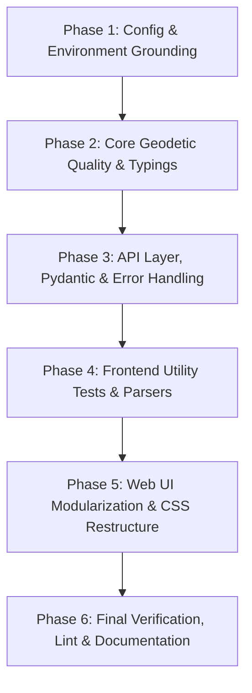

# PyTransDatRO Code Refactoring & Quality Roadmap

> [!NOTE]
> **Status: COMPLETED (Phases 1–6 Fully Executed & Sealed)**
> All six refactoring phases outlined below have been successfully implemented, audited, and verified against ANCPI reference standards. This document is sealed and serves as an immutable architectural record.
> Future development, feature additions, bug fixes, and continuous maintenance proceed under the rules in [`GEMINI.md`](GEMINI.md) and [`.agents/rules/`](.agents/rules/).

This roadmap defines the multi-chat execution strategy that elevated PyTransDatRO to industry-standard code quality, maintainability, and clean architecture.

---

## Strategic Principles & Constraints
1. **Zero Functional Regressions**: All geodetic coordinate transformations must remain byte-for-byte identical against ANCPI/Romgeo benchmarks (`generate_ancpi_comparison_reports.py`).
2. **Pure Python Core Invariant**: `pytransdatro/` must remain standard library only (plus `numpy` strictly for deserializing binary `.spg` grids). No web dependencies, no heavy scientific C-extensions.
3. **Layer Decoupling**: `pytransdatro` (Core) has zero dependencies on `api/`. `api/` (FastAPI) wraps the core. `webapp/` (Frontend) talks strictly through standard HTTP API contracts.
4. **Lean Solo-Developer Tooling**: Fast, frictionless developer experience (Ruff for Python, native `tsc` and lightweight Vitest for frontend; no complex git hooks or heavy frameworks).

---

## Phase Overview & Chat Breakdown

---

### Phase 1: Configuration, Constants & Environment Grounding
**Goal**: Establish a unified configuration system, extract magic values, and set up project tooling.

- [x] **Python Dependencies & Tooling**:
  - Add `ruff` and `pydantic-settings` to development/API dependencies.
  - Create `pyproject.toml` or `ruff.toml` with clean defaults (line length, import sorting rules, targeted rules).
  - Remove accidental root artifacts (`v/` directory, obsolete caches).
- [x] **Centralized Configuration**:
  - Create `api/config.py` using Pydantic `BaseSettings`:
    - Server port/host, CORS origins, SQLite DB path (`usage.db`), feedback log path.
    - Rate limits (window, max requests), batch transformation line thresholds, upload file size limits.
    - Default logging level (`LOG_LEVEL`).
  - Create `.env.example` documenting all configuration knobs with sensible defaults.
- [x] **Geodetic Constants Extraction**:
  - Create `pytransdatro/constants.py` extracting hardcoded WGS84 ellipsoid constants, Stereo 70 projection constants, and default false easting/northing.
- [x] **Frontend Environment Configuration**:
  - Create `webapp/src/config.ts` loading from `import.meta.env` with fallbacks for map center, default zoom, max file size, and batch warning thresholds.

---

### Phase 2: Core Geodetic Engine Quality & Typings (`pytransdatro/`)
**Goal**: Bring the mathematical computation engine to production-grade typing, docstrings, and algorithmic clarity without touching numerical outputs.

- [x] **Complete Type Annotations**:
  - Add standard `typing` annotations across all core modules:
    - `trans_ro.py`, `trans_grid.py`, `spg_reader.py`, `proj_stereo.py`, `trans_helmert2d.py`, `utils.py`.
    - Typed signatures for 2D/3D tuples, coordinate arrays, and grid metadata.
- [x] **Eliminate Silent Errors**:
  - Replace bare `except Exception: pass` in `trans_ro.py` with explicit exceptions or structured logging/warnings.
- [x] **Refine Docstrings & Mathematical Formulas**:
  - Standardize reST/Sphinx docstrings with mathematical equations for bicubic interpolation and stereographic projection formulas.
- [x] **Regression Run**:
  - Run `pytest tests/test_trans_ro.py` and numerical comparison scripts to ensure 100.0% zero-regression.

---

### Phase 3: API Layer, Pydantic & Error Handling (`api/`)
**Goal**: Modernize FastAPI endpoints, structure error handling, eliminate code duplication, and configure standard logging.

- [x] **Standardized Logging (`logging.dictConfig`)**:
  - Configure Python standard library logging initialized from `api/config.py`.
  - Replace raw `print` statements with `logger.info`, `logger.warning`, and `logger.error`.
- [x] **Audit & Eliminate Silent Failures**:
  - Inspect `api/routes/info.py`, `api/routes/file.py`, `api/routes/legacy.py`, and `api/services/mailer.py`.
  - Replace `except Exception: pass` with explicit exception trapping and actionable error responses.
- [x] **Pydantic Schemas & Response Models**:
  - Audit all request and response schemas in `api/schemas/`.
  - Ensure uniform error response structure (`{"detail": "...", "code": "..."}`).
- [x] **FastAPI Dependency Injection**:
  - Use `api/dependencies.py` consistently for `Settings` and `TransRO` singleton access.
- [x] **Integration Test Verification**:
  - Run `pytest tests/test_api_modern.py`, `tests/test_api_legacy.py`, `tests/test_telemetry.py`.

---

### Phase 4: Frontend Utility Tests & Parsers (`webapp/src/utils/`)
**Goal**: Introduce lightweight test coverage for critical client-side parsing and serialization logic before refactoring UI components.
**Task Record**: [`.agents/tasks/20_phase4_frontend_utility_tests_and_parsers.md`](.agents/tasks/20_phase4_frontend_utility_tests_and_parsers.md)

- [x] **Vitest Setup**:
  - Add `vitest` (v5.0.5) to `webapp/package.json` with `npm test` (`vitest run`) and `npm run test:watch` scripts.
- [x] **Unit Tests for Core Parsers**:
  - `dmsParser.test.ts`: Test DMS formats, edge cases, symbols (`°`, `'`, `"`), whitespace, decimal variations, cardinal directions (13/13 passed).
  - `pointParser.test.ts`: Test single-line and batch delimiter auto-detection (tabs, spaces, commas, semicolons), point ID retention, 2D vs 3D tuples, coordinate ordering (28/28 passed).
  - `gridBounds.test.ts`: Test Romania envelope bounds validation and out-of-grid checks against national cities and boundary thresholds (10/10 passed).
- [x] **Unit Tests for Exporters**:
  - `exporters.test.ts`: Validate CSV, GeoJSON, and AutoCAD DXF output formats against reference strings (8/8 passed).
- [x] **Exporter Decoupling & Pure Generators**:
  - Extracted `generateCSVContent`, `generateGeoJSONObject`, and `generateDXFContent` in `webapp/src/utils/exporters.ts`, decoupling DOM side-effects and preserving backward-compatible download wrappers.
- [x] **Parser Refactoring & Hardening**:
  - Fixed `dmsParser.ts` collision between seconds notation (`s`) and South indicator (`S`), and added case-insensitive `d/m/s/D/M/S` splitting.
  - Fixed `pointParser.ts` angle regex heuristic to avoid false-positives for point labels containing `d`, `m`, or `s`.
- [x] **Verification & Zero Regression**:
  - 59/59 Vitest unit tests passed in 290ms.
  - 98/98 Python tests passed in 6.46s (100% geodetic numerical precision maintained).
  - `npm --prefix webapp run build` compiled clean with 0 errors.

---

### Phase 5: Web UI Modularization & CSS Architecture (`webapp/`)
**Goal**: Deconstruct the 3,500-line monolithic `components.css`, unify controls into reusable TS UI factory functions, and enforce visual consistency.
**Task Record**: [`.agents/tasks/21_phase5_web_ui_modularization_and_css_architecture.md`](.agents/tasks/21_phase5_web_ui_modularization_and_css_architecture.md)

- [x] **Modular CSS Architecture**:
  - Split `components.css` into logical modules:
    - `webapp/src/style/forms.css` (inputs, selects, sliding toggles, segmented buttons, dropzones)
    - `webapp/src/style/buttons.css` (high-contrast primary CTA, secondary, outline, copy buttons, action buttons)
    - `webapp/src/style/badges.css` (status pills, Quasigeoid height metric field, angle format badge, quality report cards)
    - `webapp/src/style/layout.css` (workbench panels, header, tabs bar, studio cards, modals, toasts)
    - `webapp/src/style/menus.css` (navbar menu triggers, dropdown menus, menu items, dividers)
    - `webapp/src/style/telemetry.css` (stats cards, charts, timeline matrix, spatial controls deck)
- [x] **Reusable UI Factory Functions (`webapp/src/ui/`)**:
  - `renderDropdownMenu(props)`: Sleek top-navigation menu item trigger (`.nav-menu-trigger`), rotating chevron, accessible keyboard navigation (`Escape`, `ArrowDown`, `ArrowUp`), auto-close.
  - `renderSegmentedControl(options, activeValue, onChange)`: ARIA radio groups, keyboard cycling.
  - `renderSelect(options, selectedValue, onChange)`: Form selects with uniform styling and focus rings.
  - `renderCopyBadge(text, copyValue, onCopied)`: Interactive copyable badges with keyboard activation.
  - `renderCopyButton(props)`: Standard code-block copy button with animated checkmark feedback.
  - Unit test suite (`webapp/src/ui/ui.test.ts`): 6/6 tests passed.
- [x] **Component Unification & Header Menu Redesign**:
  - Refactored `Header.ts` to use `renderDropdownMenu` with sleek `.nav-menu-trigger` menu-item styling for the Help menu.
  - Refactored `main.ts` shared config bar to use `renderSelect`, `renderSegmentedControl`, and `renderCopyBadge`.
  - Refactored `PointConverter.ts` and `BatchConverter.ts` to use `renderCopyButton` and standard CSS classes.
  - Cleaned up manual DOM and event handling across components.
- [x] **Accessibility & Keyboard Navigation**:
  - Enforced proper ARIA attributes (`role="radiogroup"`, `role="radio"`, `aria-checked`, `role="menu"`, `role="menuitem"`, `aria-haspopup`, `aria-expanded`).
  - Added visible high-contrast focus rings (`:focus-visible`) across all custom controls.
- [x] **Verification & Zero Regression**:
  - 65/65 Vitest unit tests passed (100% frontend utility and UI test suite).
  - `npm --prefix webapp run build` compiled clean in 275ms with 0 errors.
  - 46/46 core geodetic Python tests passed (100% numerical precision).
  - ANCPI official benchmark comparison generated byte-for-byte identical reports.

---

### Phase 6: Final Verification, Tooling Audit & Documentation
**Goal**: Run end-to-end audit, finalize developer guides, and seal the codebase.
**Task Record**: [`.agents/tasks/22_phase6_final_verification_tooling_audit_and_documentation.md`](.agents/tasks/22_phase6_final_verification_tooling_audit_and_documentation.md)

- [x] **Global Code Quality Run**:
  - Run `ruff check pytransdatro api tests tools` and `ruff format --check pytransdatro api tests tools` (50/50 files clean with 0 errors).
  - Run all Python tests (`pytest`: 98/98 passed).
  - Run all Webapp tests (`npm --prefix webapp test`: 65/65 passed).
  - Run full benchmark verification against ANCPI reference sets (9,046 points, $< 10^{-9}$ tolerance, 100% byte-for-byte identical).
  - Scanned for anti-patterns: 0 bare `except: pass`, 0 boundary violations in `pytransdatro/`, 0 hardcoded `localhost:8000`.
- [x] **Documentation Refresh (via `doc-record` skill)**:
  - Updated `docs/architecture.md`, `README.md`, and `webapp/README.md` to reflect the new configuration files, modular styles, and testing workflows.
  - Updated `docs/rest_api.md` with structured error schemas and `docs/web_app.md` with modular CSS architecture and Vitest commands.
  - Updated `docs/testing.md` with the full modern cross-layer test topology.
- [x] **Task & Session Record**:
  - Created `.agents/tasks/22_phase6_final_verification_tooling_audit_and_documentation.md`.
  - Committed clean progress using `task-commit`.

