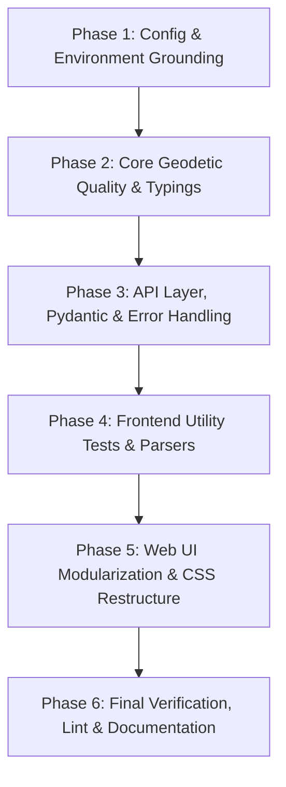

# PyTransDatRO Code Refactoring & Quality Roadmap

This roadmap defines the multi-chat execution strategy for elevating PyTransDatRO to industry-standard code quality, maintainability, and clean architecture.

Each phase is designed to be executed in a dedicated, focused chat session to prevent context degradation and maintain high precision.

---

## Strategic Principles & Constraints
1. **Zero Functional Regressions**: All geodetic coordinate transformations must remain byte-for-byte identical against ANCPI/Romgeo benchmarks (`generate_ancpi_comparison_reports.py`).
2. **Pure Python Core Invariant**: `pytransdatro/` must remain standard library only (plus `numpy` strictly for deserializing binary `.spg` grids). No web dependencies, no heavy scientific C-extensions.
3. **Layer Decoupling**: `pytransdatro` (Core) has zero dependencies on `api/`. `api/` (FastAPI) wraps the core. `webapp/` (Frontend) talks strictly through standard HTTP API contracts.
4. **Lean Solo-Developer Tooling**: Fast, frictionless developer experience (Ruff for Python, native `tsc` and lightweight Vitest for frontend; no complex git hooks or heavy frameworks).

---

## Phase Overview & Chat Breakdown

---

### Phase 1: Configuration, Constants & Environment Grounding
**Goal**: Establish a unified configuration system, extract magic values, and set up project tooling.

- [x] **Python Dependencies & Tooling**:
  - Add `ruff` and `pydantic-settings` to development/API dependencies.
  - Create `pyproject.toml` or `ruff.toml` with clean defaults (line length, import sorting rules, targeted rules).
  - Remove accidental root artifacts (`v/` directory, obsolete caches).
- [x] **Centralized Configuration**:
  - Create `api/config.py` using Pydantic `BaseSettings`:
    - Server port/host, CORS origins, SQLite DB path (`usage.db`), feedback log path.
    - Rate limits (window, max requests), batch transformation line thresholds, upload file size limits.
    - Default logging level (`LOG_LEVEL`).
  - Create `.env.example` documenting all configuration knobs with sensible defaults.
- [x] **Geodetic Constants Extraction**:
  - Create `pytransdatro/constants.py` extracting hardcoded WGS84 ellipsoid constants, Stereo 70 projection constants, and default false easting/northing.
- [x] **Frontend Environment Configuration**:
  - Create `webapp/src/config.ts` loading from `import.meta.env` with fallbacks for map center, default zoom, max file size, and batch warning thresholds.

---

### Phase 2: Core Geodetic Engine Quality & Typings (`pytransdatro/`)
**Goal**: Bring the mathematical computation engine to production-grade typing, docstrings, and algorithmic clarity without touching numerical outputs.

- [x] **Complete Type Annotations**:
  - Add standard `typing` annotations across all core modules:
    - `trans_ro.py`, `trans_grid.py`, `spg_reader.py`, `proj_stereo.py`, `trans_helmert2d.py`, `utils.py`.
    - Typed signatures for 2D/3D tuples, coordinate arrays, and grid metadata.
- [x] **Eliminate Silent Errors**:
  - Replace bare `except Exception: pass` in `trans_ro.py` with explicit exceptions or structured logging/warnings.
- [x] **Refine Docstrings & Mathematical Formulas**:
  - Standardize reST/Sphinx docstrings with mathematical equations for bicubic interpolation and stereographic projection formulas.
- [x] **Regression Run**:
  - Run `pytest tests/test_trans_ro.py` and numerical comparison scripts to ensure 100.0% zero-regression.

---

### Phase 3: API Layer, Pydantic & Error Handling (`api/`)
**Goal**: Modernize FastAPI endpoints, structure error handling, eliminate code duplication, and configure standard logging.

- [x] **Standardized Logging (`logging.dictConfig`)**:
  - Configure Python standard library logging initialized from `api/config.py`.
  - Replace raw `print` statements with `logger.info`, `logger.warning`, and `logger.error`.
- [x] **Audit & Eliminate Silent Failures**:
  - Inspect `api/routes/info.py`, `api/routes/file.py`, `api/routes/legacy.py`, and `api/services/mailer.py`.
  - Replace `except Exception: pass` with explicit exception trapping and actionable error responses.
- [x] **Pydantic Schemas & Response Models**:
  - Audit all request and response schemas in `api/schemas/`.
  - Ensure uniform error response structure (`{"detail": "...", "code": "..."}`).
- [x] **FastAPI Dependency Injection**:
  - Use `api/dependencies.py` consistently for `Settings` and `TransRO` singleton access.
- [x] **Integration Test Verification**:
  - Run `pytest tests/test_api_modern.py`, `tests/test_api_legacy.py`, `tests/test_telemetry.py`.

---

### Phase 4: Frontend Utility Tests & Parsers (`webapp/src/utils/`)
**Goal**: Introduce lightweight test coverage for critical client-side parsing and serialization logic before refactoring UI components.

- [ ] **Vitest Setup**:
  - Add `vitest` to `webapp/package.json` with a minimal `npm test` script.
- [ ] **Unit Tests for Core Parsers**:
  - `dmsParser.test.ts`: Test DMS formats, edge cases, symbols (`°`, `'`, `"`), whitespace, decimal variations.
  - `pointParser.test.ts`: Test single-line and batch delimiter auto-detection (tabs, spaces, commas, semicolons), point ID retention, 2D vs 3D tuples.
  - `gridBounds.test.ts`: Test Romania envelope bounds validation and out-of-grid checks.
- [ ] **Unit Tests for Exporters**:
  - `exporters.test.ts`: Validate CSV, GeoJSON, and AutoCAD DXF output formats against reference strings.
- [ ] **Parser Refactoring & Hardening**:
  - Clean up parser edge cases with complete test protection.

---

### Phase 5: Web UI Modularization & CSS Architecture (`webapp/`)
**Goal**: Deconstruct the 3,500-line monolithic `components.css`, unify controls into reusable TS UI factory functions, and enforce visual consistency.

- [ ] **Modular CSS Architecture**:
  - Split `components.css` into logical modules:
    - `webapp/src/style/forms.css` (inputs, selects, toggles, segmented buttons)
    - `webapp/src/style/buttons.css` (CTA buttons, icon copy buttons, secondary actions)
    - `webapp/src/style/badges.css` (status pills, metric chips, angle format badge)
    - `webapp/src/style/layout.css` (workbench panels, header, tabs bar, drawers)
    - `webapp/src/style/telemetry.css` (stats cards, charts, timeline matrix)
- [ ] **Reusable UI Factory Functions (`webapp/src/ui/`)**:
  - Create vanilla TS helper functions for uniform controls:
    - `renderSegmentedControl(options, activeValue, onChange)`
    - `renderSelect(options, selectedValue, onChange)`
    - `renderCopyBadge(text, copyValue)`
- [ ] **Component Unification**:
  - Refactor `PointConverter.ts`, `BatchConverter.ts`, `FileUpload.ts`, `TelemetryDashboard.ts` to use standard UI helpers and unified CSS classes.
- [ ] **Accessibility & Keyboard Navigation**:
  - Ensure all custom controls have proper ARIA attributes (`role="switch"`, `aria-checked`) and focus rings.
- [ ] **Build Verification**:
  - Verify `npm --prefix webapp run build` passes with zero errors.

---

### Phase 6: Final Verification, Tooling Audit & Documentation
**Goal**: Run end-to-end audit, finalize developer guides, and seal the codebase.

- [ ] **Global Code Quality Run**:
  - Run `ruff check .` and `ruff format --check .`.
  - Run all Python tests (`pytest`).
  - Run all Webapp tests (`npm --prefix webapp test`).
  - Run full benchmark verification against ANCPI reference sets.
- [ ] **Documentation Refresh (via `doc-record` skill)**:
  - Update `docs/architecture.md`, `README.md`, and `webapp/README.md` to reflect the new configuration files, modular styles, and testing workflows.
  - Update `docs/rest_api.md` with structured error schemas and `docs/web_app.md` with modular CSS architecture.
- [ ] **Task & Session Record**:
  - Commit clean progress using `task-commit`.
